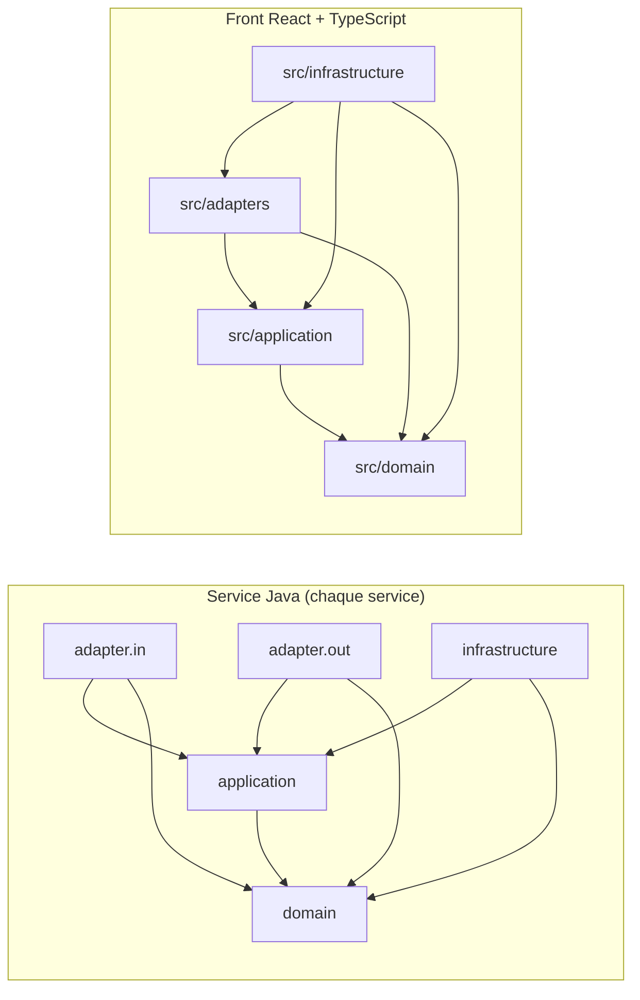
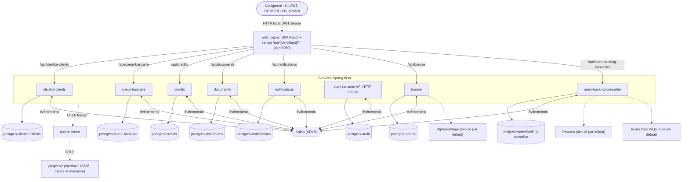
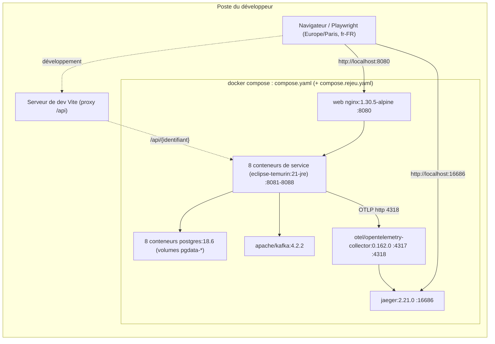

# Architecture Spine — next-banking-webapp

Brouillon (Fast path). Les marques **[ADOPTED]** désignent ce qui est imposé par `docs/quality-gates.md` ou décidé par l'utilisateur ; **[ASSUMPTION]** désigne une proposition à confirmer. En cas d'écart avec `docs/quality-gates.md`, c'est `docs/quality-gates.md` qui fait foi ; en cas d'écart avec une exigence du PRD, c'est le PRD qui fait foi. Les versions sont celles de `versions-verifiees.md`, et elles seules.

## Design Paradigm

**Microservices hexagonaux (ports et adaptateurs), reliés par des événements Kafka ; front hexagonal.**

Back, dans chaque service `services/<identifiant>/`, paquet racine `fr.nextbanking.<identifiantsanstiret>` (par exemple `fr.nextbanking.coeurbancaire`) :

| Paquet | Contenu | Dépendances autorisées |
| --- | --- | --- |
| `domain` | entités, objets-valeurs, règles métier, machines d'états | `java.*` et le code du service |
| `application` | cas d'usage ; ports entrants `application.port.in`, ports sortants `application.port.out` | `java.*`, `domain` |
| `adapter.in` | contrôleurs HTTP (`adapter.in.http`), écouteurs Kafka, déclencheurs des traitements planifiés (`adapter.in.planification`) | `application`, `domain`, frameworks |
| `adapter.out` | persistance JDBC, outbox et publication Kafka, horloge (`adapter.out.horloge`), jeton (`adapter.out.jeton`), fournisseurs externes (`adapter.out.fournisseur`, réels et simulés) | `application`, `domain`, frameworks |
| `infrastructure` | configuration Spring, assemblage des cas d'usage, lecture et validation de la configuration | `application`, `domain`, frameworks |

`domain` et `application` sont du Java pur : seules dépendances autorisées, `java.*` et le code du service ; aucun import Spring, Jakarta, Jackson ni autre bibliothèque ; aucune dépendance vers `adapter` ou `infrastructure`. Les adaptateurs ne dépendent pas les uns des autres, ni de `infrastructure` (règle de l'onion ArchUnit) : ils sont trouvés par le scan des composants, `infrastructure` n'assemble que les cas d'usage.

Front, sous `frontend/` : `src/domain` (types et règles pures, formats d'affichage du legacy), `src/application` (cas d'usage et ports), `src/adapters` (tout ce qui est React : écrans, routeur ; clients HTTP ; stockage du jeton), `src/infrastructure` (point d'entrée, assemblage, configuration). `src/domain` et `src/application` sont du TypeScript pur : aucun import de paquet npm, hors fichiers de test.



Une flèche signifie « peut dépendre de ». Aucune flèche ne part de `domain` ni de `src/domain`.

## Invariants & Rules

### AD-1 — Hexagone back vérifié par ArchUnit [ADOPTED]

- **Binds:** tous les services ; NFR-QG-01.
- **Prevents:** du code Spring, Jakarta ou Jackson dans le métier ; un adaptateur appelé depuis le domaine ; deux équipes qui placent les ports à des endroits différents.
- **Rule:** packages `domain`, `application`, `adapter.in`, `adapter.out`, `infrastructure` (Design Paradigm). Dans chaque service, une classe `HexagonalArchitectureTest` (motif `*ArchitectureTest`) avec deux règles : sens des dépendances (`Architectures.onionArchitecture()` : `domainModels("..domain..")`, `applicationServices("..application..")`, adaptateurs `in`, `out`, `infrastructure`), et aucun framework dans domain et application (`resideOutsideOfPackages("java..", "<racine>.domain..", "<racine>.application..")`). Les autres règles d'architecture (Horloge, AD-19 ; clients HTTP, AD-4) vivent dans des classes `*ArchitectureTest` séparées, pour que la classe hexagonale garde exactement ses deux règles. `archRule.failOnEmptyShould` reste à `true` ; les cinq paquets contiennent donc chacun au moins une classe dès la story 1.1, dont un type `public` sous `adapter` (exigé par `canary-arch.sh`). Bloquant à chaque build. Les transactions sont ouvertes par un port sortant `application.port.out.Transaction` (implémenté dans `adapter.out.persistance`), qui offre aussi `executerIndependamment(...)` (nouvelle transaction, AD-18) : aucune annotation transactionnelle dans `application`.
- **Preuve :** `scripts/gates/build.sh` (exécute `mvn -B -q test -Dtest='*ArchitectureTest'` : chaque module de `services/` doit porter au moins une classe de ce motif) ; `scripts/gates/canary-arch.sh services/coeur-bancaire fr/nextbanking/coeurbancaire` et `scripts/gates/canary-arch.sh services/notifications fr/nextbanking/notifications`, chacun avec la sortie attendue `OK  ArchUnit détecte la dépendance domaine -> adaptateur`. Livré par la story 1.2 de l'epic 1 (les scripts existent, installés par le pilote ; le test ArchUnit arrive avec la story 1.2).

### AD-2 — Hexagone front vérifié par dependency-cruiser [ADOPTED]

- **Binds:** `frontend/` ; NFR-QG-02.
- **Prevents:** React ou une bibliothèque d'état dans `src/domain` ou `src/application` ; un écran qui contient une règle métier.
- **Rule:** Tout ce qui est React vit dans src/adapters (hors fichiers de test). Configuration `frontend/.dependency-cruiser.cjs`, règles en sévérité error : `domain-ne-depend-de-rien`, `application-ne-depend-pas-des-adaptateurs`, `hexagone-sans-paquet-npm` (types `npm`, `npm-dev`, `npm-optional`, `npm-peer`, `npm-bundled`, `npm-no-pkg`, `npm-unknown`, `core`, fichiers `*.test.ts(x)` exclus) ; `options.tsPreCompilationDeps: true`. Bloquant. `frontend/package-lock.json` est versionné dès la story 1.1 (`build.sh` lance `npm ci`).
- **Preuve :** `scripts/gates/build.sh` (exécute `npx depcruise --config .dependency-cruiser.cjs src` dans `frontend/`) ; test négatif : ajouter `import { useState } from "react"` dans un fichier de `src/application`, puis `cd frontend && npx depcruise --config .dependency-cruiser.cjs src` doit sortir avec un code non nul. Livré par la story 1.2 (qui crée `frontend/.dependency-cruiser.cjs`, AD-10).

### AD-3 — Une base PostgreSQL par service [ADOPTED]

- **Binds:** tous les services ; AD-14.
- **Prevents:** une jointure ou une lecture dans la base d'un autre service ; un couplage de schéma entre équipes.
- **Rule:** une base PostgreSQL par service ; aucun service ne lit la base d'un autre. Un conteneur `postgres-<identifiant>` par service dans `compose.yaml`, avec un utilisateur et un mot de passe propres au service et un volume nommé `pgdata-<identifiant>` (les données survivent à `docker compose down` sans `-v`, FR-002-09, FR-023-06). Un service ne connaît que l'adresse et les identifiants de sa base (`SPRING_DATASOURCE_URL` en `jdbc:postgresql://postgres-<identifiant>:5432/...`). Le schéma de chaque base est versionné dans son service (Flyway, version gérée par le BOM Spring Boot ; starter `spring-boot-starter-flyway` et module `flyway-database-postgresql` [ASSUMPTION : noms d'artefacts Boot 4 à vérifier à la story 1.4]).
- **Preuve :** `docker compose -f compose.yaml config --services | grep -c '^postgres-'` vaut `8` (2 pendant l'epic 1) ; configuration résolue : `docker compose -f compose.yaml config --format json | jq -r '.services | to_entries[] | select(.key|test("^postgres-")|not) | select(.value.environment.SPRING_DATASOURCE_URL) | "\(.key) \(.value.environment.SPRING_DATASOURCE_URL)"' | awk '$2 !~ "//postgres-"$1"[:/]" {print "KO", $0}'` n'affiche rien ; en complément, `for d in services/*/; do n=$(basename "$d"); grep -rhoE 'postgres-[a-z-]+' "$d/src/main/resources" | sort -u | grep -vx "postgres-$n" && echo "KO $n"; done` n'affiche aucun `KO`. Livré par la story 1.4 (`compose.yaml`).

### AD-4 — Kafka, seul bus entre services [ADOPTED]

- **Binds:** tous les échanges entre services ; FEAT-023, FEAT-024, FEAT-025, FEAT-026.
- **Prevents:** des appels HTTP synchrones entre services, qui recréeraient un couplage temporel et contourneraient la propriété des données.
- **Rule:** bus entre services : Kafka. Les services ne s'appellent jamais en HTTP. Un service qui a besoin d'une donnée d'un autre service tient une projection locale, dans sa propre base, alimentée par les événements Kafka de ce service [ASSUMPTION]. Projections décidées (contrats dans AD-22) : clients (`identite-clients.client-modifie.v1`) dans cœur bancaire, crédits et documents ; comptes et opérations (`coeur-bancaire.compte-modifie.v1`, `coeur-bancaire.operation-enregistree.v1`) dans documents. Aucun service ne projette les soldes d'un autre pour un affichage : les écrans qui combinent plusieurs domaines appellent chaque service depuis le front (AD-17). Seules les classes de `adapter.out.fournisseur` dépendent d'un client HTTP (`RestClient`, `WebClient`, `RestTemplate`, `java.net.http.HttpClient`), et seulement vers un fournisseur externe (AD-20). Conventions des événements : AD-18 et AD-22.
- **Preuve :** test ArchUnit `ClientsHttpArchitectureTest` dans chaque service (aucune classe hors de `..adapter.out.fournisseur..` ne dépend des quatre clients HTTP ci-dessus), exécuté par `scripts/gates/build.sh` ; complément non bloquant : `! grep -rnE 'http://(identite-clients|coeur-bancaire|credits|documents|notifications|audit|bourse|open-banking-conseiller)' services/*/src/main compose*.yaml` ; `scripts/gates/trace-smoke.sh` (span d'émission et span de consommation Kafka). Livré par la story 1.2 (règle ArchUnit) et la story 1.4 (flux témoin).

### AD-5 — Tracing OpenTelemetry vers Jaeger v2, sans span créé à la main [ADOPTED]

- **Binds:** tous les services ; NFR-OBS-01, NFR-OBS-02, NFR-QG-09, NFR-PERF-01 (mesure).
- **Prevents:** une trace coupée entre deux services ; un échantillonnage partiel en local ; des spans écrits à la main que chaque équipe nommerait à sa façon.
- **Rule:** tracing : spring-boot-starter-opentelemetry, export OTLP vers un collecteur OpenTelemetry, backend Jaeger v2. Dépendances `org.springframework.boot:spring-boot-starter-opentelemetry` et `net.ttddyy.observation:datasource-micrometer-spring-boot` (2.x). Propriétés, à poser explicitement dans chaque service :
  - `management.opentelemetry.tracing.export.otlp.endpoint=http://otel-collector:4318/v1/traces` (pas de valeur par défaut ; transport par défaut `http`) ;
  - `management.tracing.sampling.probability=1.0` (défaut **0.1**, à surcharger). Échantillonnage à 1.0 en local ;
  - `spring.kafka.template.observation-enabled=true` (défaut **false**, à surcharger) ;
  - `spring.kafka.listener.observation-enabled=true` (défaut **false**, à surcharger).
  Aucun span créé à la main. Spans JDBC via datasource-micrometer 2.x. Contexte propagé sur HTTP et sur Kafka. Les écouteurs Kafka en mode batch sont interdits (ils ne sont pas observés par défaut). L'ancienne propriété `management.otlp.tracing.export.enabled` n'est jamais utilisée. Les tâches planifiées sont observées automatiquement (observation `tasks.scheduled.execution`, auto-configuration `ScheduledTasksObservationAutoConfiguration` du jar `spring-boot-micrometer-observation` 4.1.1) à condition que `@EnableScheduling` et un `ObservationRegistry` soient présents : aucun service ne remplace le planificateur par un autre mécanisme. La durée d'un parcours (NFR-PERF-01) se lit sur la durée des spans de sa trace.
- **Preuve :** `scripts/gates/trace-smoke.sh` : échoue si la trace du flux témoin (AD-15) ne contient pas deux services distincts, au moins un span JDBC, un span d'émission et un span de consommation Kafka sous le même identifiant de trace. Le script n'existe pas encore (`check-gates-exist.sh` le réclame) : livré par la story 1.4 (AD-10).

### AD-6 — Lancement local par `compose.yaml` [ADOPTED]

- **Binds:** environnement local ; tous les services ; NFR-SEC-06.
- **Prevents:** des environnements locaux différents d'une équipe à l'autre ; un Jaeger v1 en fin de vie ; un démarrage instable (service lancé avant sa base) ; un secret committé.
- **Rule:**
  - `compose.yaml` à la racine construit les images et lance les services, une base `postgres-<identifiant>` par service, Kafka, le collecteur et Jaeger, plus le conteneur web du front (`web`, port publié 8080). Chaque service applicatif porte exactement son identifiant comme nom de service compose.
  - Images : `postgres:18.6` ; `apache/kafka:4.2.2` (KRaft, aligné sur kafka-clients 4.2.1) ; `otel/opentelemetry-collector:0.162.0` (configuration montée sur `/etc/otelcol/config.yaml`, ports 4317 et 4318 ; OTLP en entrée et en sortie seulement) ; `cr.jaegertracing.io/jaegertracing/jaeger:2.21.0` (Jaeger v2, interface sur 16686, réception OTLP du collecteur). **Jamais l'image all-in-one de Jaeger v1.** Services : construction sur `eclipse-temurin:21`, exécution sur `eclipse-temurin:21-jre`. Conteneur web : `nginx:1.30.5-alpine`, qui sert la SPA construite sur Node 24.21.0 (étape de construction `node:24.21.0-alpine` [ASSUMPTION : tag à vérifier à la story 1.4]). `TZ=Europe/Paris` dans chaque conteneur.
  - Santé et ordre de démarrage : un `healthcheck` sur chaque conteneur (`pg_isready` pour les bases, `kafka-broker-api-versions.sh` pour Kafka, `/actuator/health` pour les services, seul point d'actuator exposé) ; `depends_on` avec `condition: service_healthy` ; `make rejeu-up` attend que tout soit sain.
  - Kafka mono-broker : `KAFKA_AUTO_CREATE_TOPICS_ENABLE=false`, `KAFKA_OFFSETS_TOPIC_REPLICATION_FACTOR=1`, `KAFKA_TRANSACTION_STATE_LOG_REPLICATION_FACTOR=1` (topics déclarés par leur producteur, AD-18).
  - Réseau compose à sous-réseau fixe, déclaré dans `nb.reseau.mandataires-de-confiance` de chaque service (AD-17) [ASSUMPTION : `172.30.0.0/24`].
  - Secrets : les secrets viennent de variables d'environnement, jamais d'un fichier versionné (NFR-SEC-06). `make secrets` génère `.env` (mots de passe aléatoires des bases) et la paire RSA du jeton dans `.secrets/`, tous deux dans `.gitignore` ; `.env.example` versionné, sans valeur. Dans `compose.yaml`, une variable secrète s'interpole avec une valeur par défaut vide (`${NB_..._MOT_DE_PASSE:-}`), jamais `${VAR:?}`, pour que `docker compose config --services` sorte en code 0 sans secret ; le service refuse de démarrer sans valeur.
  - Journaux sur la sortie console, `traceId` et `spanId` dans chaque ligne (corrélation Micrometer).
  - Le profil de rejeu s'ajoute par `compose.rejeu.yaml` (AD-11).
- **Preuve :** `docker compose -f compose.yaml config --services` ; `scripts/gates/check-gates-exist.sh` (lignes `compose : collecteur OpenTelemetry`, `compose : Jaeger`, `compose : service <nom>` à `OK`) ; `! grep -nE 'jaegertracing/all-in-one' compose.yaml` ; `docker compose -f compose.yaml config --format json | jq '[.services[] | select(.healthcheck == null)] | length'` vaut `0` ; `git ls-files .env .secrets` vide ; `trivy fs --scanners secret --exit-code 1 .`. Livré par la story 1.4 (`compose.yaml`, collecteur, Jaeger, conteneur web et `frontend/Dockerfile`), étendu service par service.

### AD-7 — Couverture par couche [ADOPTED]

- **Binds:** tous les services et le front ; NFR-QG-03, NFR-QG-04.
- **Prevents:** un seuil qui varie d'un service à l'autre ; une exclusion de couverture ajoutée pour passer ; un fichier de configuration front que le contrôle ne lit pas.
- **Rule:**
  - Back : JaCoCo check en phase verify, configuré **une fois dans le POM parent** (exécutions `prepare-agent`, puis `report` et `check`). 100 % lignes et branches sur domain et application (`<element>PACKAGE</element>`, `<include>*.domain*</include>`, `<include>*.application*</include>`, `<minimum>1.00</minimum>`), 80 % sur adapter et infrastructure (`*.adapter*`, `*.infrastructure*`, `<minimum>0.80</minimum>`). Bloquant. `haltOnFailure` n'est jamais à `false`.
  - Front : Vitest coverage.thresholds par glob, mêmes seuils, dans **un seul fichier de configuration, `frontend/vite.config.ts`**, qui porte aussi le proxy de développement (AD-17) et `@vitejs/plugin-react` ; aucun `vitest.config.*` (`check-gates-exist.sh` prend le premier fichier de `ls vitest.config.* vite.config.*`, trié, donc `vite.config.ts` s'il existe). Bloc `test.coverage` : provider `v8` ; `src/domain/**` et `src/application/**` à 100 (lines, branches, functions, statements) ; `src/adapters/**` et `src/infrastructure/**` à 80. Bloquant.
- **Preuve :** `scripts/gates/build.sh` (`mvn -B -q verify -DfailIfNoTests=true` puis `npx vitest run --coverage`) ; `scripts/gates/check-gates-exist.sh` (lignes `seuil 100 % présent`, `seuil 80 % présent`, `front : seuils de couverture Vitest`, `front : seuil dédié au domaine`) ; `ls frontend/vitest.config.* 2>/dev/null` vide. Livré par la story 1.3 (`vite.config.ts` créé par la story 1.1, complété par la 1.3 pour les seuils et par la 1.4 pour le proxy).

### AD-8 — Mutation à la demande [ADOPTED]

- **Binds:** domain et application de chaque service ; `src/domain` et `src/application` du front ; NFR-QG-05, NFR-QG-06.
- **Prevents:** des tests sans assertion qui atteignent 100 % de couverture ; PIT dans le build par défaut.
- **Rule:**
  - Back : PIT dans le profil Maven mutation (POM parent), sur domain et application (`targetClasses` `fr.nextbanking.*.domain.*` et `fr.nextbanking.*.application.*`), mutationThreshold 85, historique activé : `historyInputFile` et `historyOutputFile` à `${user.home}/.cache/next-banking-webapp/pit/${project.artifactId}.history`, hors de `target/`. Plugin `pitest-junit5-plugin`. PIT n'apparaît dans aucun autre profil.
  - Front : StrykerJS, `frontend/stryker.config.json`, `testRunner` `vitest`, `mutate` sur `src/domain` et `src/application` (fichiers de test exclus), thresholds break 85 / high 90 (`low` 85), mode incremental (`incrementalFile` `reports/stryker-incremental.json`, `reports/` ignoré par git).
  - À la demande.
- **Preuve :** `scripts/gates/mutation.sh` ; `scripts/gates/check-gates-exist.sh` (lignes `profil mutation avec PIT`, `seuil de mutation 85`, `historique PIT configuré`, `PIT actif hors profil mutation` absente, `Stryker break 85`). Livré par la story 1.5.

### AD-9 — CVE : Dependency-Check et Trivy [ADOPTED]

- **Binds:** dépendances Maven et npm ; NFR-QG-07, NFR-QG-08.
- **Prevents:** une vulnérabilité corrigeable livrée ; un scan qui télécharge sa base en plein contrôle ; une clé NVD dans le dépôt.
- **Rule:**
  - CVE back : OWASP Dependency-Check dans le profil Maven security (POM parent), failBuildOnCVSS 7, clé d'API NVD via settings.xml (`nvdApiServerId` `nvd`, jamais `nvdApiKey` dans un POM), OSS Index et Node Audit désactivés, mise à jour de la base désactivée pendant les scans (`autoUpdate` à `false`), suppressions dans `config/dependency-check-suppressions.xml`.
  - CVE back et front : Trivy fs, sévérités HIGH et CRITICAL. Porte bloquante avec --ignore-unfixed ; les vulnérabilités sans correctif sont journalisées dans reports/ (`reports/cve-all.json`, `reports/cve-unfixed.tsv`), sans bloquer. Suppressions dans `.trivyignore`.
  - Prérequis de `scripts/gates/cve.sh`, sur le poste qui l'exécute : `trivy` 0.75.0 (jamais 0.69.4 à 0.69.6) et `jq` installés ; clé NVD dans `~/.m2/settings.xml` (étape 5 du pilote) ; bases à jour **avant** le run, par l'humain (étapes 9 et 10 du pilote) : `trivy fs --download-db-only .` et `mvn -Psecurity org.owasp:dependency-check-maven:update-only -Ddc.autoUpdate=true`. Le script, lui, lance Trivy avec `--skip-db-update --skip-java-db-update`.
  - Une suppression (`.trivyignore`, `config/dependency-check-suppressions.xml`) est ajoutée par un humain seulement, datée et motivée.
- **Preuve :** `scripts/gates/cve.sh` ; `scripts/gates/check-gates-exist.sh` (lignes `profil security avec Dependency-Check`, `failBuildOnCVSS 7`, `base Dependency-Check figée pendant les scans`, `OSS Index désactivé`, `config/dependency-check-suppressions.xml présent`, `.trivyignore présent`). Livré par la story 1.6 (le script existe ; les deux fichiers de suppression existent, vides, créés à l'étape 5 du pilote).

### AD-10 — Un agent ne modifie jamais un contrôle [ADOPTED]

- **Binds:** tous les agents et toutes les stories ; NFR-QG-10.
- **Prevents:** un contrôle rouge « réparé » en baissant un seuil ou en désactivant un test ; une story bloquée parce qu'elle doit créer un fichier protégé.
- **Rule:**
  - Un contrôle rouge se corrige dans le code ou dans les tests, jamais en modifiant le contrôle. Fichiers interdits de modification : `scripts/gates/**`, `.bmad-loop/policy.toml`, `.bmad-loop/gates.sha256`, `.claude/settings.json`, `.claude/hooks/**`, `docs/quality-gates.md`, `frontend/.dependency-cruiser.cjs`, `.trivyignore`, `config/dependency-check-suppressions.xml`. Interdit d'abaisser un seuil, d'ajouter une exclusion de couverture ou de mutation, de désactiver un test. Si un seuil paraît inatteignable : s'arrêter et le signaler, ne pas contourner.
  - Qui crée les fichiers protégés : `scripts/gates/*.sh` (hors `trace-smoke.sh`) sont déjà installés par le pilote ; `.trivyignore` et `config/dependency-check-suppressions.xml` sont déjà créés, vides (étape 5 du pilote) ; `frontend/.dependency-cruiser.cjs` est créé par la story 1.2 et `scripts/gates/trace-smoke.sh` par la story 1.4, pendant l'epic 1, avant que l'empreinte et le hook existent.
  - L'empreinte `.bmad-loop/gates.sha256` est figée par l'humain à l'étape 10 du pilote, après l'epic 1 et la relecture des scripts (`sha256sum scripts/gates/*.sh frontend/.dependency-cruiser.cjs .trivyignore config/dependency-check-suppressions.xml`, plus `replay-mapping.json` et les fichiers de `e2e/golden-master` de la piste golden master) ; le hook de protection est installé à l'étape 11. À partir de là, seul l'humain modifie un contrôle (déverrouillage explicite) et régénère l'empreinte.
- **Preuve :** à partir de l'epic 2, `sha256sum -c .bmad-loop/gates.sha256` (première commande `[verify]` de `.bmad-loop/policy.toml`) ; pour toute story, `git diff --name-only "$(git merge-base origin/main HEAD)"...HEAD -- scripts/gates .bmad-loop/policy.toml .bmad-loop/gates.sha256 .claude/settings.json .claude/hooks docs/quality-gates.md frontend/.dependency-cruiser.cjs .trivyignore config/dependency-check-suppressions.xml` vide (sauf, pendant l'epic 1, la création des deux fichiers ci-dessus par leur story) ; `scripts/gates/check-gates-exist.sh` en code 0.

### AD-11 — Rejeu du golden master [ADOPTED]

- **Binds:** FEAT-001 à FEAT-017 (écrans et pages rejoués) ; NFR-PAR-01, NFR-PAR-04, NFR-PAR-05, NFR-UI-01, NFR-UI-02.
- **Prevents:** un rejeu dépendant de l'heure réelle, du fuseau de la machine ou des rejeux précédents ; un sélecteur ou un texte changé en cours de route, découvert seulement au rejeu final.
- **Rule:**
  - URL de base unique `http://localhost:8080/`, table des routes (15 routes de la SPA, 2 points d'API sans rendu) et connexion de test (formulaire `/login`, `login-identifiant`, `login-mot-de-passe`, `login-me-connecter`, jeton en `localStorage` conservé par `storageState`) : **`golden-master-architecture.md`**, §0 à §2, qui fait foi.
  - `data-testid` : convention de EXPERIENCE.md, `{écran}-{élément}[-{identifiant métier}]`, minuscules ASCII sans accent, préfixes d'écran fixés ; un `data-testid` publié à l'étape G2 ne change plus.
  - Textes : repris à l'identique du legacy, casse rendue comprise (le golden master compare `innerText` ; les capitales du legacy sont produites par `text-transform` CSS, sans normalisation au rejeu) ; seuls écarts : la liste fermée de EXPERIENCE.md.
  - Fenêtre de 5 000 caractères : toute section nouvelle se place après le contenu comparé dans l'ordre du DOM ; seul le lien d'évitement précède.
  - Listes déroulantes en `<select>` natifs, valeurs d'option identiques au legacy ; boutons avec un texte visible dans `<button>` ou `<a>`.
  - Données de référence : `services/<identifiant>/reference-data/reference-data.sql`, avec les identifiants du legacy. Les projections (AD-22) font partie des données de référence : le `reference-data.sql` d'un service consommateur contient ses projections, **générées** depuis le `reference-data.sql` du producteur par `scripts/generer-projections-reference.sh`, jamais écrites à la main [ASSUMPTION : nom du script].
  - `make reset-data` (appelle `scripts/reset-reference-data.sh`), idempotent : arrête les consommateurs Kafka, vide dans chaque base les tables métier, les projections, `outbox`, `outbox_audit` et `evenements_traites`, supprime puis recrée les topics (ce qui efface aussi les offsets validés des groupes), recharge les 8 `reference-data.sql`, replace les séquences, puis relance les consommateurs.
  - Profil de rejeu : `make rejeu-up` (`compose.yaml` + `compose.rejeu.yaml`, profil Spring `rejeu`), port Horloge (AD-19) réglé au démarrage sur `HORLOGE_DEPART` (défaut `2026-11-17T10:00:00` Europe/Paris) puis qui avance, un seul `HORLOGE_DECALAGE` pour tous les services ; traitements planifiés métier désactivés (AD-21) ; fournisseurs simulés.
  - Navigateur du rejeu à l'heure et dans la langue de Paris : Playwright avec `timezoneId: 'Europe/Paris'` et `locale: 'fr-FR'` (AD-23).
  - Écarts voulus avec le legacy (scénarios adaptés ou exclus, comportement d'origine, comportement cible, raison, couverture) : **`ecarts-voulus-golden-master.md`**. Décisions de rejeu : `replay-mapping.json` (racine, versionné), sélecteurs écrits `[data-testid='…']` avec apostrophes, partout.
  - Runner : Playwright Test, tests générés dans `e2e/golden-master`, jamais retouchés à la main ; rejeu complet par `make rejeu-golden-master`.
- **Preuve :** dérivation à blanc `uv run docs/retro/tools/derive-golden-master.py derive --gm-dir docs/retro/golden-master --mapping replay-mapping.json --output-dir "$(mktemp -d)"` en code 0 (`derived` 31, `dropped` 2, `rules.lost` = [RG-010-007] : règle sortie du golden master avec l'exclusion de SC-010-02 et couverte par le test de FR-010-09) ; tests générés à jour : `uv run docs/retro/tools/export-golden-master-tests.py --runner playwright --derived docs/retro/golden-master/derived --mapping replay-mapping.json --gm-dir docs/retro/golden-master --output e2e/golden-master --check` en code 0 ; idempotence : trois `make reset-data` successifs, puis comptage des lignes de chaque base identique ; déterminisme de SC-003-04 : `make rejeu-up` puis trois fois `make reset-data && (cd e2e/golden-master && npx playwright test --grep "SC-003-04")` verts, et contre-épreuve `HORLOGE_DEPART=2026-11-17T23:30:00 make rejeu-up` qui fait échouer SC-003-04. `make reset-data`, `make rejeu-up`, `compose.rejeu.yaml`, l'installation de Playwright et les données de référence complètes sont livrés par la story « Socle du rejeu final du golden master », dans le **dernier epic** (pas dans l'epic 1, qui n'a que deux services).

### AD-12 — Contrôle de fraude d'un virement [ADOPTED]

- **Binds:** FEAT-003, FEAT-016, FEAT-021, FEAT-023, FEAT-027 ; FR-027-02, FR-027-11, FR-027-16, FR-027-17, FR-016-19, FR-002-10, FR-003-27, FR-023-02, FR-026-03, FR-026-04 ; NFR-SEC-08, NFR-SEC-09, NFR-OBS-02 ; décisions D1 à D9, B2, B4 à B7 ; risques R-1, R-2, R-4.
- **Prevents:** un débit avant décision ; deux débits ou aucun ; deux notifications pour un virement ; une libération qui gagne contre l'expiration ; une entrée d'audit perdue avec l'opération ; un délai technique ou un moyen de traçage différent selon l'équipe.
- **Rule:**
  - Décision synchrone et locale au cœur bancaire, dans le domaine, sans appel réseau ; même cas d'usage pour le virement immédiat et pour chaque échéance d'un virement programmé (B2). Aucun point d'entrée public d'évaluation isolée du score (RP-08). Les signaux d'historique (fréquence du jour, succession rapide, vélocité, puis cumul glissant) sont lus par un port unique `HistoriqueVirements` ; le contrôle et l'enregistrement du virement d'un même client sont sérialisés par un verrou consultatif de transaction (`pg_advisory_xact_lock(clientId)`), soumis au même `lock_timeout` que l'accès à l'historique [ASSUMPTION].
  - Machine à 5 états dans `domain` : EXÉCUTÉ, SUSPENDU, LIBÉRÉ, REJETÉ, REFUSÉ_ERREUR_CONTRÔLE. Transitions permises : soumission → EXÉCUTÉ | SUSPENDU | REFUSÉ_ERREUR_CONTRÔLE ; SUSPENDU → LIBÉRÉ | REJETÉ ; LIBÉRÉ → EXÉCUTÉ | REJETÉ (motif « solde insuffisant au débit », audit `TRANSFER_REJECT_INSUFFICIENT_FUNDS`, acteur SYSTEM, B7). Toute autre transition est refusée. Chaque transition suit AD-24 (mise à jour conditionnelle, première transition gagne). Un virement REFUSÉ_ERREUR_CONTRÔLE est persisté (état terminal, identifiant), pour son audit et sa référence.
  - Moment du débit, par parcours : virement immédiat ou échéance programmée EXÉCUTÉ → débit et crédit dans la transaction de soumission (mise à jour conditionnelle `solde >= montant`), le consommateur de `virement-a-traiter.v1` ne débite pas ; LIBÉRÉ → le consommateur de `virement-a-traiter.v1` débite par la transition conditionnelle LIBÉRÉ → EXÉCUTÉ, ou applique LIBÉRÉ → REJETÉ pour solde insuffisant (B7), sans notification.
  - Atomicité de l'effet : la transition, le débit éventuel, la remise au traitement asynchrone (`coeur-bancaire.virement-a-traiter.v1`, consommé par le cœur bancaire lui-même, en remplacement de la file JMS `virements`) et l'événement de décision sont écrits dans la même transaction (outbox, AD-18) ; un échec d'écriture fait échouer l'opération (FR-023-02). Même règle pour la libération (avec le passage des alertes OPEN à REVIEWED, B4), le rejet et le rejet automatique.
  - Audit (FR-026-03, FR-026-04) : chaque entrée d'audit d'un virement (VIREMENT avec son issue, TRANSFER_EXECUTED, ADMIN_TRANSFER_RELEASE, ADMIN_TRANSFER_REJECT, TRANSFER_AUTO_REJECT, TRANSFER_REJECT_INSUFFICIENT_FUNDS) est écrite dans la table `outbox_audit` par `Transaction.executerIndependamment(...)`, transaction indépendante de celle du virement : elle est conservée même si l'opération est annulée, y compris quand la validation échoue (FR-023-02). Elle n'est jamais écrite dans la transaction du virement.
  - Réponse de `POST /api/coeur-bancaire/virements` : `etat`, `heureButoir` (si SUSPENDU), `reference` (identifiant de trace, si REFUSÉ_ERREUR_CONTRÔLE) et l'écho des champs saisis (compte source, destinataire, montant, motif), pour la reprise préremplie (FR-003-28) ; l'en-tête `Idempotency-Key` (UUID par soumission) est enregistré avec le virement sous contrainte d'unicité, une deuxième soumission de la même clé renvoie le premier résultat [ASSUMPTION].
  - Unique notification produite à la décision du contrôle : événement `coeur-bancaire.virement-decide.v1`, dont le cœur bancaire décide tout le contenu de notification (CONFIRMATION, ALERTE ou FRAUDE, texte rendu ; AD-25). Aucune notification à la remise au traitement asynchrone, à la libération, au rejet, au rejet automatique, ni pour un refus pour erreur du contrôle.
  - Commandes Libérer et Rejeter : rôle ADMIN vérifié dans le service, motif obligatoire, identité tracée ; la libération contrôle le solde à l'instant de la commande (B6).
  - Heure butoir = soumission + 24 heures calendaires, calculée par le port Horloge ; elle fait foi (B5) : Libérer compare l'horloge à l'heure butoir et refuse à l'heure butoir ou après. Rejet automatique par un traitement planifié du cœur bancaire, toutes les minutes [ASSUMPTION : fréquence], qui rejette les virements SUSPENDU dont l'heure butoir est atteinte ; rejet possible la nuit et le week-end (risque R-2 accepté). Journal de ce traitement : question ouverte Q2.
  - Signal MULTIPLE_FAILED_AUTH (FR-027-11) : identité et clients compte les échecs consécutifs de connexion par client existant (remise à zéro au succès, échecs d'un compte désactivé compris) et publie `identite-clients.echecs-connexion-repetes.v1` au 5e échec, puis à chaque échec suivant ; le cœur bancaire, seul propriétaire de `FRAUD_ALERTS`, crée l'alerte OPEN à la réception. Aucun service ne consomme un topic d'audit hormis le service audit.
  - Seuils (score 75, seuil de fraude 10 000 €, plafond du cumul glissant 10 000 €, seuil d'alerte 5 000 €, seuil de mise en attente 5 000 €) en configuration de déploiement `nb.fraude.*` du seul cœur bancaire, validés au démarrage : une valeur invalide empêche le démarrage (NFR-SEC-08).
  - Expiration technique de l'accès aux données d'historique (NFR-SEC-09) : **2 secondes**, propriété `nb.fraude.acces-historique.delai=2s`, validée au démarrage (strictement positive) [ASSUMPTION : chiffre à confirmer]. L'adaptateur `adapter.out` de l'historique l'applique par `java.sql.Statement#setQueryTimeout` et `SET LOCAL lock_timeout` PostgreSQL (dans la transaction ouverte par le port `Transaction`) ; son dépassement est traduit en erreur du contrôle, donc REFUSÉ_ERREUR_CONTRÔLE.
  - Traçage du contrôle sans span créé à la main (NFR-OBS-02) : le contrôle s'exécute dans la requête HTTP observée (ou dans la tâche planifiée observée, pour une échéance, AD-5) et dans les spans JDBC de datasource-micrometer, qui montrent l'accès à l'historique et son expiration. L'adaptateur entrant enrichit l'**observation courante**, créée par l'instrumentation automatique, avec `virement.controle.issue` (`EXECUTE`, `SUSPENDU`, `REFUSE_ERREUR_CONTROLE`) et, en cas d'erreur, lui signale l'erreur (statut d'erreur de la trace). Créer une Observation Micrometer (`Observation.createNotStarted`, `Observation.start`, `@Observed`) **compte comme un span créé à la main** et est interdit, comme `@NewSpan` et toute construction de span [ASSUMPTION : interprétation de la règle « aucun span créé à la main »]. La référence affichée par l'écran de refus (FR-003-27) est l'identifiant de la trace courante, lu par l'adaptateur entrant et renvoyé dans le champ `reference` de l'erreur.
  - Statut d'affichage SUCCESS/PENDING distinct des 5 états ; la mention « [EN ATTENTE] » de BUG-009 (risque R-4, corrigé par FR-003-29) et le texte « transaction importante » vivent dans un seul fichier de textes du cœur bancaire. Le découpage d'un virement sous les seuils reste possible jusqu'au cumul glissant (risque R-1, FR-027-18).
- **Preuve :** tests du cœur bancaire `mvn -B -q -f services/coeur-bancaire/pom.xml test -Dtest='MachineEtatsVirement*Test,ControleFraude*Test,EcheanceRevue*Test,LiberationVirement*Test,AuditVirement*Test'` (critères d'acceptation de FR-027-02, FR-027-16, FR-027-17, FR-016-19, FR-002-10, FR-026-03, avec horloge injectée) ; test d'intégration « remise impossible → aucun virement, aucun débit, une entrée VIREMENT présente dans `outbox_audit` » ; démarrage refusé sur seuil invalide : test `ConfigurationFraude*Test` ; absence de span manuel : `! grep -rnE 'Observation\.(createNotStarted|start)\(|@Observed|@NewSpan|spanBuilder\(|nextSpan\(' services/*/src/main --include=*.java` ; trace du refus : test d'intégration avec `nb.fraude.acces-historique.delai=1ms` (ou un verrou tenu sur la table de l'historique), puis `curl -s http://localhost:16686/api/traces/<reference>` contient `virement.controle.issue` et un statut d'erreur. Livrés par la story du socle RG-027-003 (epic fonctionnelle des virements, hors epic 1).

### AD-13 — Thème du front exporté de DESIGN.md [ADOPTED]

- **Binds:** `frontend/` ; tous les écrans ; DESIGN.md, EXPERIENCE.md.
- **Prevents:** des couleurs et espacements recopiés à la main, qui divergent d'un écran à l'autre ; une dépendance à Tailwind non vérifiée ; une police chargée depuis un CDN.
- **Rule:**
  - Pas de Tailwind. `npm run tokens` exécute `npx @google/design.md export --format css-tailwind` (`@google/design.md` 0.4.0, format alpha), puis `frontend/scripts/tokens-root.mjs`, script versionné qui convertit le bloc `@theme { … }` produit en `:root { … }` (mêmes propriétés personnalisées CSS) [ASSUMPTION]. Résultat : `frontend/src/adapters/ui/theme/tokens.css`, fichier généré, jamais retouché.
  - Les écrans n'utilisent que ces variables CSS, au travers des composants du design system et des extensions de DESIGN.md. Aucun écran ne style un élément natif : un élément natif (`<select>`, `<table>`, `<input>`) n'est stylé que par le composant qui l'enveloppe. Le style ne change jamais un texte affiché ni un `data-testid`.
  - Accessibilité (EXPERIENCE.md, plancher WCAG 2.1 AA) : `lang="fr"` dans `index.html` ; rôles `alert`/`status`, `aria-*` et gestion du focus portés par les composants du design system, jamais ajoutés écran par écran.
  - Polices servies par le conteneur web (auto-hébergées), jamais par un CDN, ni dans le front ni au rejeu ; Inter en repli de Graphik [ASSUMPTION].
- **Preuve :** `cd frontend && npm run tokens && git diff --exit-code src/adapters/ui/theme/tokens.css` (le fichier versionné est à jour) ; `! grep -n '@theme' frontend/src/adapters/ui/theme/tokens.css` ; complément non bloquant (sélecteurs imbriqués, CSS modules et `style={{…}}` non vus) : `! grep -rnE '^\s*(select|table|input|button|a|th|td)\s*[,{]' frontend/src --include=*.css | grep -v 'src/adapters/ui/'` ; `! grep -rnE 'fonts\.(googleapis|gstatic)\.com' frontend/src frontend/index.html`. Livré par la première story d'écran (connexion, FEAT-001) [ASSUMPTION : affectation ; la story 1.1 n'en porte rien].

### AD-14 — Huit services et propriété des données [ADOPTED]

- **Binds:** tous les services ; FEAT-001 à FEAT-030.
- **Prevents:** une table possédée par deux services ; une saga entre comptes et virements ; un solde modifié hors du cœur bancaire ; deux producteurs de PDF.
- **Rule:**
  - Microservices Java 21, Spring Boot 4, Maven. Un module par service sous services/<nom>/, POM parent à la racine. Le POM parent (`pom.xml`) porte JaCoCo et les profils mutation et security. `<nom>` est l'identifiant ci-dessous.
  - 8 services, chacun seul propriétaire de ses tables (tables du legacy, DATA-DICTIONARY.md) :

  | Service | Identifiant | Tables possédées |
  | --- | --- | --- |
  | Identité et clients | `identite-clients` | `CUSTOMERS` (connexion, rôles, conseiller affecté) |
  | Cœur bancaire | `coeur-bancaire` | `BANK_ACCOUNTS`, `TRANSACTIONS`, `TRANSFERS`, `RECURRING_TRANSFERS`, `EXTERNAL_BENEFICIARIES`, `FRAUD_ALERTS`, `BUDGETS`, `BATCH_JOB_LOGS` |
  | Crédits | `credits` | `LOANS`, `LOAN_REPAYMENTS`, `CREDIT_SCORES`, `RISK_PROFILES` |
  | Documents | `documents` | `DOCUMENTS` |
  | Notifications | `notifications` | `NOTIFICATIONS` |
  | Audit | `audit` | `AUDIT_LOGS` |
  | Bourse | `bourse` | `WATCHLIST_ITEMS` |
  | Open banking et conseiller | `open-banking-conseiller` | `BANK_PRODUCTS`, `SAVINGS_PRODUCTS`, `CREDIT_PRODUCTS`, `INVESTMENT_PRODUCTS`, état Powens par client (AD-20) |

  - `BATCH_JOB_LOGS` : chaque service garde le journal de ses propres traitements planifiés (aujourd'hui, tous au cœur bancaire, AD-21). Les références entre services (`CUSTOMER_ID`, `ACCOUNT_ID`) sont des identifiants numériques copiés, sans clé étrangère entre bases. Aucune lecture de la base d'un autre service (AD-3) ; projections locales par événements (AD-4, AD-22). Débit et crédit d'un virement sont atomiques dans la seule base du cœur bancaire.
  - Seul le cœur bancaire modifie un solde, et seulement par ses propres cas d'usage. Ni le paiement d'une échéance de prêt ni l'approbation d'un prêt ne déplacent d'argent (FR-007-12, FR-024-06) ; un mouvement d'argent demandé par un autre service demandera une nouvelle AD [ASSUMPTION].
  - Documents est le seul service qui produit un PDF (relevé, RIB, attestation, IFU) ; il tient trois projections : comptes, opérations, clients (AD-22). L'attestation porte le solde de la projection (retard de projection admis) et la date du port Horloge de documents. Le traitement des relevés mensuels (FEAT-020) du cœur bancaire ne fait que journaliser (FR-020-02) : il n'écrit ni document ni PDF.
- **Preuve :** preuves de AD-3, AD-4 et AD-22 ; `ls services/` liste exactement les 8 identifiants une fois le découpage complet ; `! grep -rlE 'UPDATE +bank_accounts' services/*/src/main --include=*.java --include=*.sql | grep -v '^services/coeur-bancaire/'`.

### AD-15 — Epic 1 : deux services et flux témoin [ADOPTED]

- **Binds:** epic 1 (fondations) ; NFR-QG-00, NFR-QG-09.
- **Prevents:** des contrôles livrés sur un squelette qui ne traverse aucun service ; une story fonctionnelle commencée avant les contrôles ; un epic 1 surchargé.
- **Rule:** l'epic 1, « Fondations contrôlées », suit l'ordre du pilote : 1.1 squelette (POM parent, deux services hexagonaux minimaux `coeur-bancaire` et `notifications`, front hexagonal minimal, build vert) ; 1.2 contrôles d'architecture ; 1.3 couverture ; 1.4 flux témoin tracé (`compose.yaml`, collecteur, Jaeger, `trace-smoke.sh`) ; 1.5 mutation ; 1.6 CVE. Il n'a pas de story 1.7. Flux témoin : requête HTTP → `coeur-bancaire` → écriture dans sa base → publication Kafka par l'outbox (`coeur-bancaire.temoin-ecrit.v1`) → `notifications` consomme → écriture dans sa base. Le point d'API témoin (`POST /api/coeur-bancaire/temoin`) figure dans la liste fermée des chemins publics (AD-16), pour que `trace-smoke.sh` reste vert quand la vérification du jeton arrive [ASSUMPTION]. Aucune story fonctionnelle ne démarre avant que les contrôles bloquants soient livrés et verts.
- **Preuve :** `scripts/gates/trace-smoke.sh` (livré par la story 1.4) ; `scripts/gates/check-gates-exist.sh` en code 0 à la fin de l'epic 1.

### AD-16 — Authentification sans BFF, par JWT [ADOPTED]

- **Binds:** FEAT-001, FEAT-015, FEAT-030 ; tous les services ; NFR-SEC-01, NFR-SEC-02, NFR-SEC-03, NFR-SEC-06, NFR-SEC-07 ; BUG-093.
- **Prevents:** un contrôle d'accès fait seulement par le front ; un conseiller qui lit n'importe quel client ; un format de jeton, une durée ou un statut de refus différents d'un service à l'autre ; un chemin public ouvert par défaut.
- **Rule:**
  - Formulaire `/login` → `POST /api/identite-clients/connexion` → le service identité et clients vérifie le mot de passe haché (`DelegatingPasswordEncoder`, encodage `{bcrypt}`) et émet un JWT signé par `NimbusJwtEncoder` (`spring-security-oauth2-jose`). Pas de passerelle, pas de BFF, pas d'Authorization Server. Le `reference-data.sql` d'identité contient les hachés, générés par un script depuis les variables d'environnement des mots de passe de démonstration, jamais en clair dans le dépôt.
  - Clé privée seulement dans identité et clients (`adapter.out.jeton`) ; clé publique fournie par configuration à chaque service ; paire RSA générée par `make secrets` dans `.secrets/` (AD-6) [ASSUMPTION : RSA].
  - Revendications : `sub` (identifiant du client), `roles` (CLIENT, CONSEILLER, ADMIN), `jti` (unique par émission), `iat`, `exp`.
  - Le front conserve le jeton dans `localStorage` (clé `nb.jeton`), jamais en `sessionStorage`, et l'envoie en `Authorization: Bearer`.
  - Tout `/api/**` est authentifié par défaut. Liste fermée des chemins publics, comparés en entier (FR-030-01) : `POST /api/identite-clients/connexion`, `GET /api/open-banking-conseiller/powens/retour`, `POST /api/coeur-bancaire/temoin` (AD-15) ; plus les ressources statiques servies par `web`.
  - Chaque service vérifie le jeton par `spring-boot-starter-security-oauth2-resource-server` et vérifie lui-même les rôles. L'appartenance d'une ressource se décide dans le service qui détient la ressource, d'après le jeton et sa propre projection, jamais d'après une liste d'identifiants fournie par le front : CLIENT, ressources dont `clientId = sub` ; CONSEILLER, ressources des clients dont `conseillerId = sub` dans la projection `identite-clients.client-modifie.v1` ; ADMIN, toutes. Les points d'API du conseiller déduisent le portefeuille côté serveur (`GET /api/<service>/conseiller/portefeuille`) ; la latence de projection est acceptée. Ressource existante d'un autre client : 403 ; ressource inexistante : 404 ; dans les deux cas `{"message"}` (FR-008-04). Exceptions (décisions du 2026-10-05) : documents d'un compte : téléchargement par le titulaire seul ; virement programmé d'un autre client : 404, identique à une ressource absente (FR-004-10). Le front redirige aussi, mais ne fait jamais foi.
  - Correspondance avec les exigences de session (NFR-SEC-02, FR-001-09) : aucun identifiant n'est émis avant l'authentification (aucune réponse publique ne pose de cookie ni de jeton) ; chaque connexion émet un nouveau jeton (`jti` neuf) ; jeton expiré → 401 → message de page expirée (FR-030-05).
  - Durée de vie : 30 minutes (NFR-SEC-07) ; le front demande un nouveau jeton (`POST /api/identite-clients/renouvellement`) sur activité quand il reste moins de 10 minutes ; sans activité, le jeton expire [ASSUMPTION : mécanisme de l'inactivité]. 60 minutes en profil de rejeu. Le renouvellement refuse (401) un client supprimé ; `GET /api/identite-clients/moi` renvoie 401 pour un client supprimé ou inexistant, et le front traite tout 401 en supprimant `nb.jeton` et en affichant `/login`. Client désactivé : question ouverte Q1.
  - `iat` et `exp` sont calculés avec l'horloge système (`java.time.Clock` système injectée dans `adapter.out.jeton` et dans la vérification), jamais avec le port Horloge (AD-19).
  - Déconnexion (FR-001-10) : le front supprime le jeton du stockage local, appelle `POST /api/identite-clients/deconnexion` (audit LOGOUT), puis affiche `/login` ; pas de liste de révocation, la durée de vie courte borne le risque [ADOPTED] (décision Q1 (a) du 2026-10-05 : un jeton reste valable jusqu'à son expiration, sans révocation immédiate ; la déconnexion suit la même logique).
  - Client désactivé (décision Q1) : la désactivation (FR-016-11) bloque immédiatement toute nouvelle connexion (FR-001-07, BUG-001) et tout renouvellement du jeton ; un jeton déjà émis reste valable jusqu'à son expiration, 30 minutes au plus. Les services ne refusent pas un jeton valide d'après leur projection. Risque accepté R-5.
- **Preuve :** une classe `SecuriteIT` par service (requête sans jeton → 401, jeton d'un autre rôle → 403, ressource existante d'un autre client → 403, conseiller hors portefeuille → 403), exécutée par `mvn verify` et vérifiée par `for s in services/*/; do find "$s/src/test" -name '*SecuriteIT.java' | grep -q . || echo "KO $s"; done` (aucun `KO`) ; `curl -s -o /dev/null -w '%{http_code}' http://localhost:8080/api/coeur-bancaire/tableau-de-bord` → `401`. Livré par la story de connexion (FEAT-001) pour identité et clients ; chaque service suivant pose sa vérification du jeton avec sa première story.

### AD-17 — Conventions d'API HTTP

- **Binds:** tous les services ; le front ; le conteneur web ; FR-001-13, FR-026-05, FR-026-06 ; NFR-SEC-04, NFR-PERF-01.
- **Prevents:** des préfixes, des statuts et des formats d'erreur différents d'un service à l'autre ; une adresse IP d'audit falsifiable ou égale à celle du relais ; un journal d'audit lisible ; deux calculs d'un même total.
- **Rule:**
  - Préfixe `/api/{identifiant}/**` ; le serveur de développement (proxy de `frontend/vite.config.ts`) et le conteneur web `web` (nginx) renvoient `/api/{identifiant}/**` vers le service, chemin transmis tel quel, et tout autre chemin vers `index.html` de la SPA. Le conteneur web n'a ni code métier ni contrôle d'accès. Exception : `/api/audit/**` n'est pas renvoyé ; le service audit n'expose aucun point d'API HTTP métier (FR-026-06), ses tests lisent `AUDIT_LOGS` par JDBC.
  - Adresse IP d'origine (FR-001-13, A-001-2) : le conteneur web et le proxy Vite **écrasent** `X-Forwarded-For` avec l'adresse du client (`proxy_set_header X-Forwarded-For $remote_addr`, jamais `$proxy_add_x_forwarded_for`) ; un service ne retient l'en-tête que si l'adresse distante appartient à la plage de confiance `nb.reseau.mandataires-de-confiance` (CIDR du réseau compose, AD-6), sinon il retient l'adresse distante. La résolution est faite une seule fois, dans `adapter.in.http`, et passée au cas d'usage en paramètre (puis dans l'entrée d'audit, AD-18).
  - JSON en entrée et en sortie, noms de champs en français et en camelCase (`identifiant`, `motDePasse`, `compteId`).
  - Erreur : un seul format, `{"message": "<texte affichable>"}`, plus `reference` (identifiant de trace) quand l'écran l'affiche. Décision du 2026-10-05 (étape G2, SC-001-03) : ce format n'est plus une supposition. Le `message` est toujours un texte du legacy ou de textes-nouveaux.md, y compris sur un 5xx (« Service credit temporairement indisponible… »), sans détail technique ni pile d'appels (NFR-SEC-04).
  - Pas de redirection serveur pour l'authentification : 401 sans jeton valide, 403 pour un rôle insuffisant ; la redirection vers `/login` ou `/tableau-de-bord` est faite par le routeur du front. Seule exception : `GET /api/open-banking-conseiller/powens/retour`, public, qui répond 302 vers `/comptes-tiers`.
  - Un écran qui combine plusieurs services les appelle en parallèle, jamais en cascade (NFR-PERF-01). Un total qui combine deux services (patrimoine total : cœur bancaire et comptes Powens) est calculé par le front, en centimes, à partir du total renvoyé par chaque service [ASSUMPTION].
  - La validation d'un IBAN (MOD-97, zone SEPA) n'existe qu'au cœur bancaire, exposée par `POST /api/coeur-bancaire/beneficiaires/verification-iban` ; le front ne la reproduit pas [ASSUMPTION]. Le masquage `FR76****1234` est une règle unique, avec un test de référence commun (mêmes entrées, mêmes sorties) dans chaque service qui manipule un IBAN ; pas de bibliothèque partagée entre services.
  - Ports en développement local, publiés pour le proxy Vite : identité et clients 8081, cœur bancaire 8082, crédits 8083, documents 8084, notifications 8085, audit 8086, bourse 8087, open banking et conseiller 8088 ; port 8080 dans chaque conteneur [ASSUMPTION].
- **Preuve :** `curl -s http://localhost:8080/api/identite-clients/connexion -H 'Content-Type: application/json' -d '{"identifiant":"x","motDePasse":"y"}'` → statut 401 et corps `{"message":"Identifiants incorrects"}` (SC-001-03) ; `curl -s -o /dev/null -w '%{http_code}' http://localhost:8080/tableau-de-bord` → `200` ; `curl -s -o /dev/null -w '%{http_code}' http://localhost:8080/api/audit/` → différent de 2xx ; test d'intégration par service émetteur d'audit : un `X-Forwarded-For` venant d'une adresse hors plage est ignoré, un autre venant de la plage est retenu. Livré par la story 1.4 (renvoi, conteneur web), la story de connexion (format d'erreur, adresse IP).

### AD-18 — Conventions d'événements Kafka et outbox

- **Binds:** tous les producteurs et consommateurs Kafka ; FR-026-01 à FR-026-05.
- **Prevents:** un événement perdu après une écriture validée ; une entrée d'audit perdue avec l'opération ; un doublon traité deux fois ; un message illisible par un autre service ; deux services qui se partagent un groupe de consommateurs ; des noms de topics et des enveloppes différents par équipe.
- **Rule:**
  - Topic : `{service-producteur}.{evenement-au-participe}.v{n}` en minuscules (`coeur-bancaire.virement-decide.v1`, `credits.pret-demande.v1`, `{service}.audit.v1`). Un topic n'a qu'un producteur, qui le déclare par un bean `NewTopic` dans `infrastructure` (3 partitions, réplication 1 en local). Catalogue des topics inter-services : AD-22.
  - Clé du message : identifiant numérique de l'agrégat (virement, compte, client…), pour garder l'ordre par agrégat.
  - Enveloppe JSON : `idEvenement` (UUID), `type`, `version`, `horodatage` (ISO 8601 UTC, lu sur le port Horloge), `producteur`, `donnees`.
  - Sérialisation : `StringSerializer` et `StringDeserializer` ; l'adaptateur écrit et lit l'enveloppe en JSON avec ses propres types, sans en-tête de type (`__TypeId__` jamais émis ni lu). `group.id` = identifiant du service consommateur (`spring.kafka.consumer.group-id=<identifiant>`), jamais partagé entre services.
  - Outbox transactionnelle pour toute publication liée à une écriture : la ligne `outbox` est écrite dans la même transaction que l'écriture métier. Après la validation, le même fil d'exécution la publie par `KafkaTemplate` (le span d'émission reste dans la trace de la requête) et la marque publiée ; un relais planifié republie, toutes les secondes, les lignes restées non publiées, dans l'ordre de leur identifiant [ASSUMPTION : publication après validation dans le fil de la requête, relais en secours]. Le relais est un traitement technique : il reste actif en profil `rejeu` et n'écrit pas dans le journal des traitements. Délai de bout en bout visé sur le flux témoin : 5 s au plus (attente de SC-003-04).
  - Audit (FR-026-01 à FR-026-05) : chaque service publie ses entrées sur `{service}.audit.v1`, toujours par l'outbox, jamais par un envoi direct. La ligne est écrite dans une table dédiée `outbox_audit`, par `Transaction.executerIndependamment(...)` : transaction indépendante de celle de l'opération, validée quelle que soit l'issue de celle-ci (FR-026-04). Une action sans écriture métier (LOGIN, LOGIN_FAILED, LOGOUT) n'écrit que cette ligne. `donnees` d'une entrée : `utilisateur` (texte : identifiant saisi pour LOGIN_FAILED, `clientId` sinon, `SYSTEM` pour un traitement), `action` (catalogue fermé des codes de FR-026-01 à FR-026-03 : LOGIN, LOGIN_FAILED, LOGOUT, ADMIN_DEACTIVATE, ADMIN_ACTIVATE, ADMIN_LOAN_APPROVE, ADMIN_LOAN_REFUSE, ADMIN_TRANSFER_RELEASE, ADMIN_TRANSFER_REJECT, VIREMENT, TRANSFER_EXECUTED, TRANSFER_AUTO_REJECT, TRANSFER_REJECT_INSUFFICIENT_FUNDS), `detail` (texte de la FR), `adresseIp` (résolue par AD-17 ; absente pour une action du système ou d'une échéance programmée, FR-026-05) ; l'horodatage est celui de l'enveloppe (producteur, port Horloge), jamais l'heure de réception. Clé : identifiant du virement pour les codes d'un virement (ordre de FR-026-03), identifiant de l'utilisateur sinon. Le service audit est seul à écrire `AUDIT_LOGS` ; il rejette et journalise un code inconnu.
  - Consommateurs idempotents : table `evenements_traites` (`idEvenement` en clé primaire), écrite dans la même transaction que l'effet ; un événement déjà présent est ignoré. Écouteurs unitaires, jamais en mode batch.
- **Preuve :** `scripts/gates/trace-smoke.sh` (span d'émission et de consommation sous la même trace) ; test d'intégration Testcontainers (`testcontainers-kafka`, `testcontainers-postgresql`) de chaque consommateur, qui publie un message brut (chaîne JSON de l'enveloppe, sans en-tête de type), le livre deux fois et constate un seul effet ; test d'audit par service émetteur : opération annulée → entrée présente dans `outbox_audit`. Livré par la story 1.4 pour le flux témoin ; par la story de connexion et chaque story qui audite pour l'audit.

### AD-19 — Port Horloge [ADOPTED]

- **Binds:** tous les services ; NFR-PAR-05, NFR-BATCH-03, FR-027-06, FR-027-08, FR-027-17, FR-022-04.
- **Prevents:** un résultat qui dépend de l'heure réelle ou du fuseau du processus ; un test d'échéance impossible à écrire ; un « jour » calculé en UTC par un service et à Paris par un autre.
- **Rule:**
  - Tout accès au temps métier passe par le port `application.port.out.Horloge`, implémenté dans `adapter.out.horloge` (horloge système, ou horloge réglée par `HORLOGE_DECALAGE` en profil `rejeu`). Il expose `instant()` et `aujourdhui()` (`LocalDate` dans le fuseau métier) et `fuseau()`. Le domaine reçoit le temps en paramètre.
  - Fuseau métier `Europe/Paris`, propriété `nb.fuseau=Europe/Paris` validée au démarrage, jamais lu sur `TZ` du processus. Tout découpage en heure, jour, mois ou année se fait dans ce fuseau : UNUSUAL_HOURS (06:00-23:00, FR-027-08), « jour courant » (HIGH_FREQUENCY, FR-027-06 ; plafond par compte et par jour, FR-022-04), années IFU, traitements planifiés (AD-21), garde mensuelle des intérêts et rattrapage des virements programmés.
  - Interdits hors de `adapter.out.horloge` et de `adapter.out.jeton` : toute méthode `now(..)` d'un type de `java.time` (`Instant`, `LocalDate`, `LocalDateTime`, `LocalTime`, `ZonedDateTime`, `OffsetDateTime`, `OffsetTime`, `Year`, `YearMonth`…), toute dépendance à `java.time.Clock` (dont `Clock.systemUTC()`, `Clock.systemDefaultZone()`), `System.currentTimeMillis()`. Seule exception fonctionnelle : l'émission et la vérification du JWT (AD-16), par une `java.time.Clock` système dans `adapter.out.jeton` (et la configuration du décodeur).
  - Aucun `now()`, `CURRENT_TIMESTAMP` ni `CURRENT_DATE` dans les migrations (valeur par défaut d'une colonne comprise). Les dates relatives des données de référence sont calculées depuis le port, jamais par `now()` de la base.
  - Le temps métier du front suit AD-23.
- **Preuve :** test ArchUnit `HorlogeArchitectureTest` dans chaque service : `noClasses().that().resideOutsideOfPackages("..adapter.out.horloge..", "..adapter.out.jeton..").should().callMethodWhere(target(name("now")).and(target(owner(resideInAPackage("java.time"))))).orShould().dependOnClassesThat().areAssignableTo(Clock.class)` (exécuté par `scripts/gates/build.sh` avec `-Dtest='*ArchitectureTest'`) ; `! grep -rnE '\b(Instant|LocalDate|LocalDateTime|LocalTime|ZonedDateTime|OffsetDateTime|OffsetTime|Year|YearMonth)\.now\(|Clock\.system|System\.currentTimeMillis\(' services/*/src/main --include=*.java | grep -vE '/adapter/out/(horloge|jeton)/'` ; `! grep -rniE '\b(now\(\)|current_timestamp|current_date)' services/*/src/main/resources/db/migration`. Livré par la story 1.2 [ASSUMPTION : affectation].

### AD-20 — Fournisseurs externes derrière un port, simulés par défaut [ADOPTED]

- **Binds:** FEAT-009, FEAT-010, FEAT-012, FEAT-014, FEAT-028, FEAT-029 ; NFR-INT-01, NFR-INT-02, NFR-INT-03, NFR-PERF-01 (bourse 3 000 ms).
- **Prevents:** un test ou un contrôle qui dépend du réseau ou d'une clé ; un fournisseur indisponible qui bloque l'application ; un état Powens perdu faute de session serveur.
- **Rule:**
  - Powens et Azure OpenAI (open banking et conseiller), AlphaVantage (bourse), chacun derrière un port sortant, avec un adaptateur réel et un adaptateur simulé dans `adapter.out.fournisseur`, sans appel réseau, à réponses fixes. L'adaptateur simulé est actif par défaut (local, tests, contrôles, profil `rejeu`) ; le vrai appel est une option de configuration (`nb.fournisseurs.<nom>.mode=reel`). Chaque appel réel a un délai d'attente et passe par un coupe-circuit (bibliothèque : question ouverte) ; cotations mises en cache dans le service bourse (25 requêtes par jour, 5 par minute). Indisponibilité signalée à l'utilisateur sans bloquer le reste.
  - État Powens sans session serveur : jeton Powens, comptes externes, compte sélectionné et message de résultat sont stockés côté serveur dans la base `open-banking-conseiller`, par client ; le lien entre le retour public `GET /api/open-banking-conseiller/powens/retour` et le client est un paramètre `state` signé, à usage unique, émis au lancement de la connexion ; la remise à zéro de FR-014-07 vide cet état [ASSUMPTION].
  - Historique du chat « Mon Conseiller » conservé côté front, par conversation (comme le `@SessionScoped` du legacy) ; « Nouvelle conversation » le vide ; le service ne garde aucun historique [ASSUMPTION].
- **Preuve :** test de configuration par service : contexte démarré sans aucune propriété `nb.fournisseurs.*`, le bean actif est l'adaptateur simulé ; `! grep -rnE 'mode *[:=] *reel|_MODE *[:=] *reel' services/*/src/main/resources compose*.yaml` ; sur un cache déjà rempli, `mvn -o verify` et `npm ci --offline` passent sans clé définie ; test du retour Powens avec un `state` invalide ou déjà utilisé → 302 vers `/comptes-tiers` sans effet. Livré avec la première story de chaque fournisseur.

### AD-21 — Traitements planifiés

- **Binds:** FEAT-011, FEAT-016, FEAT-018, FEAT-019, FEAT-020, FEAT-021, FEAT-022, FR-011-09, FR-016-17, FR-018-01, FR-019-01, FR-020-04, FR-021-01, FR-027-17 ; NFR-BATCH-01, NFR-BATCH-02, NFR-BATCH-03.
- **Prevents:** des horaires ou un fuseau différents selon le service ; un traitement qui modifie les soldes pendant un rejeu ; deux crédits d'intérêts dans un mois ; un journal projeté d'un service à l'autre.
- **Rule:**
  - Déclencheurs dans `adapter.in.planification`, qui appellent un cas d'usage ; `@Scheduled` avec cron et zone `Europe/Paris` explicite (observés automatiquement, AD-5). Horaires du legacy : intérêts 02:00, fraude nocturne 02:30, relevés le 1er à 03:00, virements programmés toutes les 5 minutes, soldes faibles toutes les 30 minutes ; rejet automatique des virements suspendus toutes les minutes [ASSUMPTION, AD-12]. Tous au cœur bancaire.
  - Une exécution au plus par jour calendaire (Europe/Paris) pour les traitements quotidiens et mensuels, y compris les jours de changement d'heure (garde par date dans le journal) ; aucun rattrapage des exécutions manquées (FR-019-01, FR-020-04), sauf les virements programmés, qui exécutent au cycle suivant les échéances dues pendant l'arrêt (FR-021-01). Garde « mois déjà crédité » des intérêts portée par le domaine (FR-018-01, A-018-2).
  - Journal d'exécution (NFR-BATCH-02) : une ligne par exécution dans `BATCH_JOB_LOGS` du service, colonnes du legacy (Job, Debut, Fin, Duree (ms), Enregistrements, Statut SUCCESS / FAILED / PARTIAL, Details) ; noms de jobs du legacy (INTEREST_CALCULATION, FRAUD_DETECTION, MONTHLY_STATEMENTS, RECURRING_TRANSFERS, NOTIFICATION_CHECK) ; nom du rejet automatique `SUSPENDED_TRANSFERS_EXPIRY` [ASSUMPTION] ; sa journalisation (décision Q2, exception écrite dans NFR-BATCH-02) : une ligne seulement quand il rejette au moins un virement, ou quand son exécution échoue ; une exécution sans rejet et sans erreur n'écrit rien. Chaque virement rejeté garde son entrée d'audit individuelle `TRANSFER_AUTO_REJECT`. Le relais de l'outbox n'est pas un traitement journalisé (AD-18).
  - Le journal est exposé en lecture par chaque service propriétaire (`GET /api/<service>/traitements?limite=50`), ouvert aux rôles des écrans qui l'affichent (FR-011-09 : tout utilisateur authentifié ; FR-016-17 : ADMIN). L'écran appelle directement chaque service propriétaire et fusionne les entrées par heure de début ; aucun service ne projette le journal d'un autre.
  - Tous les traitements métier sont désactivés en profil `rejeu`. Une seule instance par service en local : aucun verrou distribué.
- **Preuve :** tests des cas d'usage avec horloge injectée (dont un mois civil complet d'exécutions nocturnes → un seul crédit d'intérêts, et un jour de changement d'heure → une seule exécution) ; `docker compose -f compose.yaml -f compose.rejeu.yaml config --format json | jq '[.services[] | select(.environment.SPRING_PROFILES_ACTIVE // "" | test("rejeu"))] | length'` vaut `8`. Livré avec chaque traitement.

### AD-22 — Contrats d'événements et projections

- **Binds:** tous les producteurs et consommateurs de topics inter-services ; FEAT-008, FEAT-015, FEAT-016, FEAT-017, FEAT-022, FEAT-025, FEAT-026, FEAT-027 ; NFR-SEC-03.
- **Prevents:** un producteur et un consommateur qui nomment ou typent les champs différemment ; une projection qui applique un événement plus ancien que son état ; un contrat décidé story par story.
- **Rule:**
  - Catalogue des topics inter-services ; un topic ou un champ nouveau s'y ajoute (dans cette AD) avant la story qui le produit :

  | Topic | Producteur | Consommateurs | Clé | Champs de `donnees` |
  | --- | --- | --- | --- | --- |
  | `identite-clients.client-modifie.v1` | identite-clients | coeur-bancaire, credits, documents | `clientId` | `clientId`, `login`, `nomComplet`, `role`, `actif`, `conseillerId`, `dateCreation`, `supprime`, `versionAgregat` |
  | `identite-clients.echecs-connexion-repetes.v1` | identite-clients | coeur-bancaire | `clientId` | `clientId`, `nombreEchecs` |
  | `coeur-bancaire.compte-modifie.v1` | coeur-bancaire | documents | `compteId` | `compteId`, `clientId`, `numero`, `type`, `iban`, `bic`, `solde`, `versionAgregat` |
  | `coeur-bancaire.operation-enregistree.v1` | coeur-bancaire | documents | `compteId` | `operationId`, `compteId`, `instant`, `libelle`, `type`, `montant`, `soldeApres`, `versionAgregat` |
  | `coeur-bancaire.virement-decide.v1` | coeur-bancaire | notifications | `virementId` | `virementId`, `clientId`, `etat`, `notification` (AD-25) |
  | `coeur-bancaire.solde-faible-detecte.v1` | coeur-bancaire | notifications | `compteId` | `compteId`, `notification` |
  | `coeur-bancaire.echeance-non-executee.v1` | coeur-bancaire | notifications | `virementProgrammeId` | `virementProgrammeId`, `notification` |
  | `credits.pret-decide.v1` | credits | notifications | `pretId` | `pretId`, `clientId`, `statut`, `notification` |
  | `{service}.audit.v1` | chaque service qui audite | audit | AD-18 | AD-18 |
  | `coeur-bancaire.temoin-ecrit.v1` | coeur-bancaire | notifications | `temoinId` | `temoinId` (flux témoin de l'epic 1) |

  Topics internes à un service (producteur = consommateur) : `coeur-bancaire.virement-a-traiter.v1`, `credits.pret-demande.v1`.
  - Chaque topic a un schéma JSON `contrats/evenements/<topic>.schema.json`, avec un exemple, écrit et versionné par le **seul** service producteur ; un changement incompatible crée `v{n+1}`.
  - Les événements qui alimentent une projection portent l'**état complet** de l'agrégat (jamais un delta) et un entier `versionAgregat` croissant ; un consommateur n'applique un événement que si `versionAgregat` est strictement supérieur à celui qu'il détient (sinon ignoré, en plus de `evenements_traites`), ce qui neutralise un ancien message republié par le relais.
  - JSON sans en-tête de type ; `group.id` = identifiant du service consommateur (AD-18).
  - Test de contrat : le producteur vérifie que chaque message produit a exactement les champs requis du schéma ; le consommateur désérialise l'exemple du schéma et constate l'effet [ASSUMPTION : comparaison des champs avec Jackson, sans bibliothèque de validation JSON Schema].
- **Preuve :** pour chaque topic livré du catalogue, `test -f contrats/evenements/<topic>.schema.json` ; tests de contrat `*ContratEvenement*Test` du producteur et du consommateur, exécutés par `mvn verify`. Livré par la story qui produit le topic (schéma, test producteur) et par chaque story consommatrice (test consommateur) ; `coeur-bancaire.temoin-ecrit.v1` par la story 1.4.

### AD-23 — Temps métier côté front

- **Binds:** `frontend/` ; FR-004-04, FR-006-02, FR-008-05, FR-008-06 ; NFR-PAR-05.
- **Prevents:** un écran qui propose le mois réel quand les services vivent à la date de rejeu ; un affichage qui dépend du fuseau de la machine Playwright.
- **Rule:** le front ne lit jamais l'horloge du navigateur pour une valeur métier : `Date.now()`, `new Date()` sans argument et `Temporal.Now` sont interdits dans `frontend/src/domain` et `frontend/src/application`, par une règle bloquante (test Vitest `frontend/src/architecture-temps.test.ts` qui parcourt les sources de ces deux dossiers et échoue sur ces motifs, exécuté par `scripts/gates/build.sh`) [ASSUMPTION : outil ; ni ESLint ni nouvelle dépendance]. Toute date métier d'un écran (date du jour, mois courant, années IFU, liste des mois de relevés, date minimale d'un virement programmé) est fournie par le service propriétaire dans sa réponse (champ `aujourdhui` en `yyyy-MM-dd`, calculé par son port Horloge en Europe/Paris). Les formateurs de `src/domain` convertissent un instant UTC par `Intl.DateTimeFormat('fr-FR', { timeZone: 'Europe/Paris' })`, jamais dans le fuseau du navigateur. Le rejeu Playwright fixe `timezoneId: 'Europe/Paris'` et `locale: 'fr-FR'` (AD-11). Seule exception : le renouvellement du jeton (AD-16), qui compare `exp` à l'horloge du navigateur, dans `src/adapters`.
- **Preuve :** `cd frontend && npx vitest run src/architecture-temps.test.ts` ; test négatif : ajouter `const d = new Date();` dans un fichier de `src/domain`, la commande sort en code non nul ; `! grep -rnE 'Date\.now\(|new Date\(\)|Temporal\.Now' frontend/src/domain frontend/src/application --include=*.ts --include=*.tsx | grep -v '\.test\.'`. Livré par la story 1.2 (règle) [ASSUMPTION : affectation].

### AD-24 — Machines d'états et transitions concurrentes

- **Binds:** toute entité à statut : virement, virement programmé et échéance, prêt, alerte de fraude, bénéficiaire ; FR-016-04, FR-016-05, FR-024-02, FR-024-06 à FR-024-08, FR-027-17.
- **Prevents:** deux transitions concurrentes qui s'appliquent toutes les deux (deux échéanciers, deux notifications, deux débits).
- **Rule:** toute entité à statut a sa machine d'états dans `domain` ; chaque transition s'écrit par une mise à jour conditionnelle sur l'état courant (`UPDATE … SET statut = ? WHERE id = ? AND statut = ?`) ; zéro ligne modifiée = transition refusée, sans effet de bord (ni échéancier, ni événement, ni audit de succès) : la première transition gagne. Une demande de prêt est « transmise » quand sa ligne d'outbox est validée ; FR-024-02 couvre l'échec de cette écriture, pas l'indisponibilité de Kafka [ASSUMPTION].
- **Preuve :** pour chaque entité à statut, un test d'intégration qui lance deux transitions concurrentes depuis le même état et constate un seul effet (`*TransitionConcurrente*Test`), exécuté par `mvn verify`. Livré avec la story de chaque entité.

### AD-25 — Notification décidée par le producteur

- **Binds:** FEAT-002, FEAT-004, FEAT-022, FEAT-024, FEAT-025, FEAT-027 ; FR-002-10, FR-004-12, FR-022-04, FR-023-03, FR-023-05, FR-025-01, FR-025-04, FR-027-04.
- **Prevents:** des seuils métier recopiés dans le service notifications ; un texte formaté de deux façons ; un plafond par compte remis à zéro par « Effacer tout ».
- **Rule:** le service producteur décide de **tout** le contenu d'une notification et le place dans le bloc `donnees.notification` de son événement (AD-22) : destinataire (`clientId`), `type` (CONFIRMATION, ALERTE, FRAUDE, ACCOUNT_BALANCE…), `titre` et `message` déjà rendus (textes du legacy ou de textes-nouveaux.md, montants et dates au format du legacy, heures en Europe/Paris). Le service notifications stocke, applique le plafond **par utilisateur** (FR-025-04, `nb.notifications.plafond=20`) et affiche ; il ne lit aucun seuil métier et ne compose aucun texte. Les plafonds et dédoublonnages qui dépendent d'un autre agrégat que l'utilisateur (20 par compte et par jour, FR-022-04 ; une notification par échéance non exécutée, FR-004-12) sont comptés par le producteur, dans sa base ; un événement n'est publié que si la notification doit exister.
- **Preuve :** `! grep -rn 'nb\.fraude\.' services/notifications/src/main` ; test du cœur bancaire : 48 analyses d'un compte à 50 € dans la journée → exactement 20 événements `solde-faible-detecte` ; test de notifications : 21 notifications d'un utilisateur → la plus ancienne supprimée. Livré par la story qui produit chaque notification.

## Consistency Conventions

| Concern | Convention |
| --- | --- |
| Nommage des services | identifiants de AD-14, en kebab-case ; paquet Java `fr.nextbanking.<identifiantsanstiret>` ; module Maven `services/<identifiant>/` ; nom de service compose = identifiant |
| Nommage du code | français pour le métier (`Virement`, `ControleFraude`, `Horloge`) ; ports : `<Capacite>` dans `application.port.in` (entrants) et `application.port.out` (sortants) ; adaptateurs : `<Techno><Port>` (`JdbcHistoriqueVirements`, `PowensSimule`) |
| Identifiants | numériques (`bigint`) ; identifiants du legacy conservés dans les données de référence ; séquences replacées au-dessus du plus grand identifiant ; `idEvenement` en UUID ; entre services, toujours l'identifiant numérique (`compteId`, `clientId`), jamais le numéro de compte |
| Dates | ISO 8601 ; instant (opération, soumission, notification) en UTC dans l'API, les événements et la base (`timestamptz`) ; date seule (échéance, date de prêt, mois de budget) en `yyyy-MM-dd` ; tout découpage en jour, mois ou année en Europe/Paris par le port Horloge (AD-19) ; affichage en Europe/Paris (AD-23) |
| Montants | décimal exact, jamais de flottant : `BigDecimal` à 2 décimales en Java, `numeric(19,2)` en base, chaîne décimale à point (`"100.00"`) en JSON ; arrondi `RoundingMode.HALF_UP` au centime, à la dernière étape du calcul, partout (Java et front) ; le front calcule en centimes entiers et n'envoie qu'une saisie normalisée syntaxiquement (virgule → point) : les contrôles métier et leurs messages sont faits par le service seul ; affichage au format du legacy écran par écran, par les formateurs de `src/domain` (le format « 1 234,56 € » de DESIGN.md ne s'applique pas à un texte comparé par le golden master) |
| Erreurs | format unique de AD-17 ; aucune pile d'appels ni code interne affiché (NFR-SEC-04) ; refus métier = 4xx avec `message` ; panne = 5xx avec le `message` du legacy ou de textes-nouveaux.md ; autre client 403, inexistant 404 |
| Textes | repris à l'identique du legacy ; textes nouveaux depuis textes-nouveaux.md (clés reprises telles quelles) ; un texte appartient au service qui le produit (notification, PDF, `message` d'erreur) ou au front (écrans) ; aucun texte inventé dans le code (un texte manquant est un point ouvert) |
| Journaux | sortie console, `traceId` et `spanId` dans chaque ligne ; IBAN toujours masqué (`FR76****1234`, NFR-SEC-05) : l'objet-valeur `Iban` du domaine rend la forme masquée dans `toString()` ; montants en clair (risque R-3 accepté) ; jamais de mot de passe ni de jeton |
| Configuration | propriétés métier sous le préfixe `nb.` ; seuils, délais et fuseau validés au démarrage par les objets-valeurs du domaine (une valeur invalide empêche le démarrage, NFR-SEC-08) ; secrets en variables d'environnement seulement (NFR-SEC-06, AD-6) |
| Schéma | migrations versionnées par service (Flyway) ; données de référence hors migrations (`reference-data/reference-data.sql`) ; schéma des tables internes décidé par les stories |
| Traçabilité des tests | chaque test d'acceptation porte `@Tag("FR-xxx-yy")` et, s'il prouve un bug corrigé, `@Tag("BUG-nnn")` (JUnit 5) ; côté front, le titre Vitest contient `[FR-xxx-yy]` et `[BUG-nnn]` (NFR-PAR-02, NFR-PAR-03) |
| `data-testid` | `{écran}-{élément}[-{identifiant métier}]`, minuscules ASCII sans accent ; préfixes `login`, `nav`, `dashboard`, `virement`, `vp`, `releve`, `budget`, `pret`, `documents`, `bourse`, `chat`, `produits`, `tiers`, `beneficiaires`, `conseiller`, `admin`, `revue` ; messages `{écran}-message-erreur`, `-succes`, `-info` ; tout élément interactif en porte un ; figé après G2 |

## Stack

| Name | Version |
| --- | --- |
| Java (JDK Eclipse Temurin) | 21 (21.0.12.1+1) ; images `eclipse-temurin:21` (construction) et `eclipse-temurin:21-jre` (exécution) |
| Maven | 3.9.16 |
| Spring Boot | 4.1.1 |
| Spring Security (dont `spring-security-oauth2-jose`, `NimbusJwtEncoder`) | 7.1.1 (nimbus-jose-jwt 10.9.1) |
| `spring-boot-starter-security-oauth2-resource-server` | 4.1.1 |
| `spring-boot-starter-opentelemetry` | 4.1.1 (micrometer-tracing 1.7.1, opentelemetry 1.62.0, gérés par le BOM) |
| `datasource-micrometer-spring-boot` | 2.3.0 |
| Spring Kafka / kafka-clients | 4.1.1 / 4.2.1 |
| PostgreSQL JDBC | 42.7.13 (BOM) |
| Flyway | 12.4.0 (BOM) |
| maven-surefire-plugin | 3.5.6 (géré par Boot) |
| Testcontainers (`testcontainers-postgresql`, `testcontainers-kafka`) | 2.0.5 |
| ArchUnit (`archunit-junit5`) | 1.5.1 |
| JaCoCo (`jacoco-maven-plugin`) | 0.8.15 |
| PIT (`pitest-maven`) + `pitest-junit5-plugin` | 1.30.0 + 1.2.3 |
| OWASP Dependency-Check (`dependency-check-maven`) | 13.0.0 |
| Trivy | 0.75.0 |
| PostgreSQL (image) | `postgres:18.6` |
| Kafka (image, KRaft) | `apache/kafka:4.2.2` |
| OpenTelemetry Collector (image) | `otel/opentelemetry-collector:0.162.0` |
| Jaeger v2 (image) | `cr.jaegertracing.io/jaegertracing/jaeger:2.21.0` |
| Node.js (LTS) | 24.21.0 |
| Serveur web du front (image) | `nginx:1.30.5-alpine` |
| React | 19.3.0 |
| TypeScript | 5.9.3 |
| Vite | 8.3.2 |
| `@vitejs/plugin-react` | 6.1.2 |
| React Router (`react-router`) | 8.4.0 |
| Vitest + `@vitest/coverage-v8` | 5.0.3 |
| StrykerJS (`@stryker-mutator/core` + `vitest-runner`) | 10.0.0 |
| dependency-cruiser | 18.5.0 |
| `@playwright/test` | 1.63.0 |
| `@google/design.md` | 0.4.0 (alpha) |

## Structural Seed

```text
next-banking-webapp/
  pom.xml                      # POM parent : JaCoCo, profils mutation et security
  compose.yaml                 # services, bases (volumes nommés), Kafka, collecteur, Jaeger, web
  compose.rejeu.yaml           # profil de rejeu (horloge réglée, traitements désactivés)
  Makefile                     # secrets, reset-data, rejeu-up, rejeu-golden-master
  .env.example                 # variables attendues, sans valeur (.env et .secrets/ ignorés)
  .trivyignore
  config/
    dependency-check-suppressions.xml
    otelcol/config.yaml        # collecteur : OTLP entrée, OTLP vers Jaeger
  contrats/evenements/         # un schéma JSON par topic, écrit par son producteur (AD-22)
  services/
    <identifiant>/             # un module Maven par service (AD-14)
      pom.xml
      Dockerfile
      reference-data/reference-data.sql
      src/main/java/fr/nextbanking/<id>/{domain,application,adapter/in,adapter/out,infrastructure}/
      src/main/resources/      # application.properties, db/migration
      src/test/java/.../{HexagonalArchitectureTest,HorlogeArchitectureTest,ClientsHttpArchitectureTest}.java
  frontend/
    .dependency-cruiser.cjs
    vite.config.ts             # seul fichier de configuration : plugin React, proxy /api, seuils Vitest
    stryker.config.json
    package-lock.json
    Dockerfile                 # construction Node, exécution nginx : SPA + renvoi /api/{identifiant}/**
    nginx.conf
    scripts/tokens-root.mjs    # @theme -> :root
    src/{domain,application,adapters,infrastructure}/
    src/adapters/ui/theme/tokens.css   # généré depuis DESIGN.md
  e2e/golden-master/           # tests Playwright générés, jamais retouchés
  scripts/
    gates/                     # contrôles (protégés, AD-10)
    reset-reference-data.sh
    generer-projections-reference.sh
    rejeu-golden-master.sh
  replay-mapping.json          # décisions de rejeu (étape G2), versionné
  reports/                     # sorties des contrôles, ignoré par git
```

Vue conteneurs (niveau C4 « conteneurs ») :



Déploiement local (`compose.yaml`, réseau unique à sous-réseau fixe ; seuls `web` 8080, `jaeger` 16686 et les services 8081 à 8088 sont publiés sur l'hôte) :



## Capability → Architecture Map

| Capability / Area | Lives in | Governed by |
| --- | --- | --- |
| FEAT-001 Connexion | identite-clients ; front `/login` | AD-16, AD-17 (adresse IP), AD-11, AD-18 (audit) |
| FEAT-002 Tableau de bord | front `/tableau-de-bord` ; coeur-bancaire, notifications, identite-clients, open-banking-conseiller (patrimoine total) | AD-17 (appels parallèles, total par le front), AD-11, AD-25 |
| FEAT-003 Virement | coeur-bancaire ; front `/virement` | AD-12, AD-18, AD-19, AD-24, AD-11 |
| FEAT-004 Virements programmés | coeur-bancaire ; front `/virements-programmes` | AD-12 (B2), AD-21, AD-19, AD-23, AD-25 |
| FEAT-005 Relevé de compte | coeur-bancaire ; front `/releve` | AD-14, Conventions (montants, dates) |
| FEAT-006 Budget | coeur-bancaire ; front `/budget` | AD-14, AD-23, Conventions |
| FEAT-007 Prêts | credits ; front `/prets` | AD-14, AD-18, AD-24 |
| FEAT-008 Documents | documents ; front `/documents` | AD-14 (seul producteur de PDF), AD-22 (projections comptes, opérations, clients), AD-16 (403/404), AD-23 |
| FEAT-009 Bourse et watchlist | bourse ; front `/bourse` | AD-20, AD-14 |
| FEAT-010 Chat conseiller | open-banking-conseiller ; front `/mon-conseiller` (historique côté front) | AD-20 |
| FEAT-011 Catalogue produits | open-banking-conseiller ; front `/produits` ; journal des traitements lu au cœur bancaire | AD-14, AD-21 |
| FEAT-012 Comptes tiers Powens | open-banking-conseiller ; front `/comptes-tiers` | AD-20 (état Powens côté serveur) |
| FEAT-013 Bénéficiaires externes | coeur-bancaire ; front `/beneficiaires` | AD-14, AD-17 (IBAN), Conventions (journaux) |
| FEAT-014 Callback Powens | open-banking-conseiller (`/api/open-banking-conseiller/powens/retour`) | AD-17 (exception 302), AD-20 (`state` signé) |
| FEAT-015 Espace conseiller | identite-clients ; coeur-bancaire ; credits ; front `/espace-conseiller` | AD-16 (portefeuille côté serveur), AD-22, AD-17 |
| FEAT-016 Administration | identite-clients ; credits ; coeur-bancaire (file de revue, journal des traitements) ; front `/administration` | AD-12, AD-16, AD-17, AD-21, AD-24 |
| FEAT-017 Téléchargement PDF | documents (`/api/documents/telechargement`) | AD-14, AD-16, AD-17 (401) |
| FEAT-018 Intérêts nocturnes | coeur-bancaire | AD-21 (garde mensuelle), AD-19 |
| FEAT-019 Fraude nocturne | coeur-bancaire | AD-21, AD-12 |
| FEAT-020 Relevés mensuels | coeur-bancaire (journal seul) | AD-21, AD-14 |
| FEAT-021 Exécution des virements programmés | coeur-bancaire | AD-12 (B2), AD-21 (rattrapage) |
| FEAT-022 Soldes faibles | coeur-bancaire → notifications | AD-21, AD-22, AD-25 (plafond par compte) |
| FEAT-023 Traitement asynchrone des virements | coeur-bancaire (`coeur-bancaire.virement-a-traiter.v1`) | AD-12 (moment du débit), AD-18 |
| FEAT-024 Traitement asynchrone des prêts | credits (`credits.pret-demande.v1`) | AD-18, AD-24 |
| FEAT-025 Notifications internes | notifications | AD-25, AD-22, AD-18 |
| FEAT-026 Audit trail | audit (`{service}.audit.v1`, aucune API de lecture) | AD-18 (outbox d'audit indépendante, codes), AD-17 (adresse IP), AD-14 |
| FEAT-027 Fraude temps réel | coeur-bancaire ; identite-clients (MULTIPLE_FAILED_AUTH) | AD-12, AD-5, AD-19, AD-22 |
| FEAT-028 Intégration Powens | open-banking-conseiller | AD-20 |
| FEAT-029 Intégration AlphaVantage | bourse | AD-20 |
| FEAT-030 Contrôle d'accès RBAC | tous les services ; routeur du front | AD-16 |
| Contrôles qualité (NFR-QG-00 à 10) | `scripts/gates/`, POM parent, `frontend/` | AD-1, AD-2, AD-5, AD-7, AD-8, AD-9, AD-10, AD-15 |
| Parité (NFR-PAR-01 à 05) | `e2e/golden-master/`, `Makefile`, `reference-data/`, Conventions (traçabilité des tests) | AD-11, AD-19, AD-23 |
| Performance (NFR-PERF-01) | front (appels parallèles), bourse (cache), traces | AD-17, AD-20, AD-5 |

## Risques acceptés (PRD §9)

| Risque | Rattaché à | Levé par |
| --- | --- | --- |
| R-1 — Découpage d'un virement sous les seuils | AD-12 | story du cumul glissant (FR-027-18), juste après le socle RG-027-003 |
| R-2 — Rejet automatique la nuit et le week-end | AD-12, AD-21 | hors démonstrateur (décision D8) |
| R-3 — Montants non masqués dans les journaux | Conventions (Journaux) | hors démonstrateur |
| R-4 — BUG-009 conservé provisoirement | AD-12 (statut d'affichage) | story FR-003-29, après la démonstration |
| R-5 — Un client désactivé garde l'accès jusqu'à l'expiration de son jeton, 30 minutes au plus (décision Q1 du 2026-10-05) ; la désactivation bloque le renouvellement et toute nouvelle connexion | AD-16 | révocation des jetons, hors démonstrateur |

## Deferred

- **Environnements autres que le local** (recette, production, Kubernetes, CI hébergée) : hors périmètre du PRD, démonstrateur local.
- **Scalabilité et haute disponibilité** (plusieurs instances, verrou distribué des traitements, partitionnement Kafka au-delà de 3 partitions) : une instance par service suffit au démonstrateur.
- **Sauvegarde et restauration** : aucune ; les données sont reconstruites par `make reset-data`.
- **Rétention des traces** : en mémoire dans Jaeger v2, perdues au redémarrage.
- **Métriques et alertes d'exploitation** : hors démonstrateur (traces et journaux seulement).
- **Schéma détaillé des tables internes** : décidé par les stories, dans le respect de AD-14 ; les contrats inter-services, eux, sont dans AD-22.
- **Découpage en epics et stories** (au-delà de l'epic 1 et de la story socle du rejeu final, AD-11) : `bmad-create-epics-and-stories`.
- **Décisions par scénario du golden master** (`replay-mapping.json`) : faites à l'étape G2.
- **Valeurs de production** des fournisseurs (`POWENS_CONNECTOR_ID`, clés) : RP-10, hors démonstrateur.
- **Performance au-delà de NFR-PERF-01** et campagne de mesure : à la story qui en a besoin.
- **Cumul glissant (FR-027-18)** et reprise préremplie (FR-003-28) : stories après le socle RG-027-003 (D10, D12), dans le cadre de AD-12 (port `HistoriqueVirements`, écho des champs saisis).
- **En-têtes de sécurité du conteneur web** (CSP) et **contrôle automatique d'accessibilité** (axe) : à fixer avec la story du conteneur web, outil à vérifier dans `versions-verifiees.md` avant usage.
- **Bibliothèque PDF** de documents : choisie par la première story de documents, après vérification dans `versions-verifiees.md`.
- **Épinglage des images au correctif** (`eclipse-temurin:21.0.12…`) : tags majeurs retenus pour le démonstrateur.

## Open questions

- **Q1 tranchée le 2026-10-05 (option a)** : un client désactivé garde l'accès jusqu'à l'expiration de son jeton, 30 minutes au plus. La désactivation bloque le renouvellement et toute nouvelle connexion. Voir AD-16 et le risque accepté R-5.
- **Q2 tranchée le 2026-10-05 (option a, complétée)** : le rejet automatique écrit une entrée au journal des traitements quand il rejette au moins un virement, ou quand son exécution échoue ; une exécution sans rejet et sans erreur n'écrit rien. C'est une exception inscrite dans NFR-BATCH-02 du PRD. Voir AD-21.
- **[OPEN] Coupe-circuit et cache des fournisseurs** (AD-20, NFR-INT-02) : bibliothèque commune à choisir et à vérifier dans `versions-verifiees.md` (compatibilité Boot 4.1.1), avec ses réglages communs sous `nb.fournisseurs.<nom>.*`, avant la première story de fournisseur.
- **[OPEN] Configuration Playwright générée** (AD-11, AD-23) : `export-golden-master-tests.py` n'écrit aujourd'hui ni `timezoneId` ni `locale` dans `playwright.config.ts`, fichier généré et protégé. À traiter par la story socle du rejeu final : option de l'outil d'export, sinon `TZ=Europe/Paris` et `LANG=fr_FR.UTF-8` posés par `scripts/rejeu-golden-master.sh`.
- **[OPEN] Date de référence du rejeu** (AD-11) : vérifier, dans la story « Socle du rejeu final du golden master », que `2026-11-17T10:00:00` est postérieure à toutes les dates d'`import.sql` et que `user1` a au plus 8 opérations ce jour-là, avant la première exécution de SC-003-04.
- **[OPEN] Observation Micrometer et « span créé à la main »** (AD-12) : confirmer que l'enrichissement de l'observation courante est admis et que la création d'une Observation est interdite.
- **[OPEN] Inactivité et renouvellement du jeton** (AD-16) : mécanisme d'expiration sur inactivité à faire confirmer par le métier.
- **[OPEN] Police Graphik** (AD-13) : licence d'auto-hébergement à confirmer ; sinon Inter seule.
