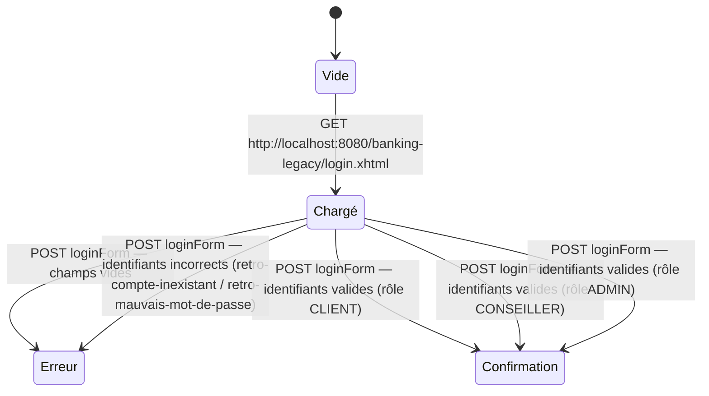

# FLOW — FEAT-001 Connexion

## Captures par état

| État | Screenshot | Rôle | Notes |
|---|---|---|---|
| Chargé | SCR-001-01_vide.png | anonymous | Formulaire affiché avec deux champs vides (Identifiant, Mot de passe) et bouton 'Me connecter'. Page titre : 'BankApp Demo - Connexion'. Accessible sans authentification. redirige toute requête non authentifiée vers cette page. |
| Erreur | SCR-001-02_erreur_validation.png | anonymous | Validation JSF required : messages 'Identifiant requis' et 'Mot de passe requis' affichés dans une liste (classe 'Project Stage[Development]: Unhandled Messages'). La page reste sur login.xhtml. |
| Confirmation | SCR-001-03_confirmation_redirect_dashboard.png | CLIENT | Redirect JSF 'faces-redirect=true' vers /dashboard.xhtml. Source :. |