# FLOW — FEAT-002 Tableau de bord

```mermaid
stateDiagram-v2
    [*] --> Vide
    Vide --> Chargé : GET /banking-legacy/dashboard.xhtml (rôle CLIENT — comptes chargés)
    Vide --> ChargéSansComptes : GET /banking-legacy/dashboard.xhtml (rôle ADMIN — aucun compte personnel)
    Vide --> ChargéSansComptes : GET /banking-legacy/dashboard.xhtml (rôle CONSEILLER — aucun compte personnel)
    Chargé --> ChargéAvecNotification : polling SSE / rafraichissement post-virement via JMS queue/virements → VirementProcessorMDB → NotificationStore
```

## Captures par état

| État | Screenshot | Rôle | Notes |
|---|---|---|---|
| Chargé | SCR-002-01_charge.png | CLIENT | Affiche solde total (EUR17 330,00), 2 comptes (COURANT + EPARGNE), 5 dernières opérations, section Open Banking. Centre de notifications : 'Aucune notification' (état vide notifications). |
| ChargéSansComptes | SCR-002-02_charge_admin.png | ADMIN | Solde total EUR0.00, tableau Dernières opérations vide (0 lignes). Nav enrichie : liens 'Espace Conseiller' + 'Administration' absents du rôle CLIENT. Correspond à l'état 'vide' des widgets comptes et opérations. |
| ChargéAvecNotification | None | CLIENT | État non observable sans soumission d'un virement. Décrit par le texte explicatif de la page : < 5000 EUR = CONFIRMATION ; 5000–10000 EUR = CONFIRMATION + ALERTE ; > 10000 EUR = CONFIRMATION + FRAUDE. Pas de formulaire sur cette page — déclenchement uniquement depuis virement.xhtml. |