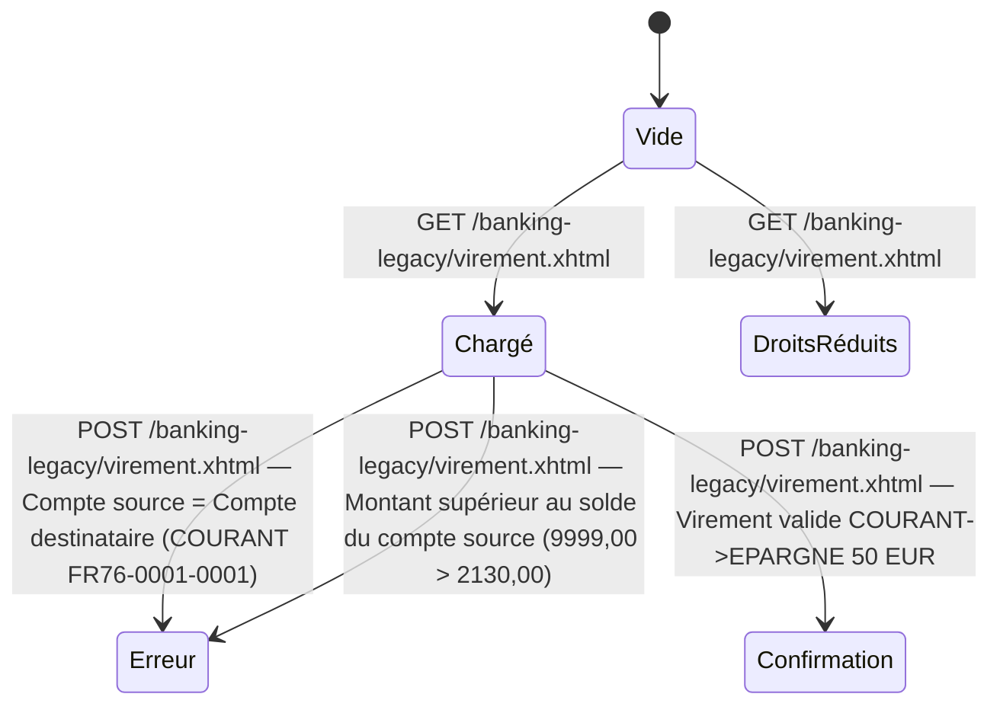

# FLOW — FEAT-003 Effectuer un virement

## Captures par état

| État | Screenshot | Rôle | Notes |
|---|---|---|---|
| Chargé | SCR-003-01_chargé.png | CLIENT | La page charge directement le formulaire avec les comptes du client dans les deux combobox (Compte source et Compte destinataire). Pas d'état intermédiaire de chargement visible. Vide et Chargé coïncident. |
| Erreur | SCR-003-02_erreur-comptes-identiques.png | CLIENT | Message d'erreur : 'Le compte source et destination doivent être différents'. Validation côté serveur (bean EJB). Formulaire réaffiché avec les valeurs saisies conservées. |
| Confirmation | SCR-003-04_confirmation-dashboard.png | CLIENT | Pas de modale de confirmation. Exécution immédiate : redirect vers /dashboard.xhtml. Notification JMS publiée sur queue/virements (ActiveMQ Artemis) visible dans le Centre de notifications du dashboard. Soldes mis à jour immédiatement. |
| DroitsRéduits | SCR-003-05_droits-reduits-conseiller.png | CONSEILLER | Page accessible mais les combobox Compte source et Compte destinataire ne contiennent que l'option vide '-- Choisir un compte --'. CONSEILLER (sophie) n'a pas de comptes clients dans le système. Le formulaire est inutilisable. |