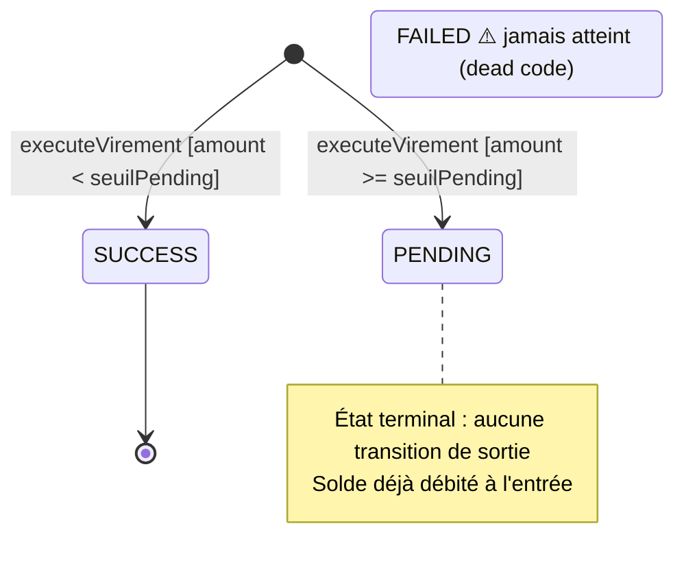

# STATES — Transfer (FEAT-003 : Effectuer un virement)

_Généré par retro-states. Source : analyse statique CodeGraph + code au commit c05512e._
_Table principale : PUBLIC.TRANSFERS — colonne STATUS (VARCHAR NOT NULL)._
_Table liée : PUBLIC.RECURRING_TRANSFERS — champ ACTIF (boolean, voir section dédiée)._

---

## Diagramme Mermaid

---

## États

| État | Libellé métier | Source | Classification | Notes |
| --- | --- | --- | --- | --- |
| `SUCCESS` | Virement exécuté | Code : `Transfer.TransferStatus.SUCCESS` | Atteint (code) | Transfert normal, montant < seuilPendingEur |
| `PENDING` | En attente de validation anti-fraude | Code : `Transfer.TransferStatus.PENDING` | Atteint (code) | Montant >= seuilPendingEur — état terminal sans sortie |
| `FAILED` | Échec de virement | Code : `Transfer.TransferStatus.FAILED` | Jamais atteint | Déclaré dans l'enum, jamais assigné — dead code |

> **Note** : La section `ENUM-transfers-status` dans `ENUMS.md` n'a pas de valeurs extraites (seconde passe retro-data incomplète). La classification atteint/jamais atteint repose uniquement sur l'analyse du code au commit analysé.

---

## Transitions

### T-001 : [*] → SUCCESS

| Champ | Valeur |
| --- | --- |
| **Déclencheur** | `VirementBean.executeVirement()` → `TransferService.executeTransfer()` |
| **Garde** | `amount > 0` ET `solde_source >= amount` ET `amount < seuilPendingEur` (défaut 5 000 EUR — env : `SEUIL_PENDING_EUR`) |
| **Acteur habilité** | Tout rôle authentifié (CLIENT, CONSEILLER, ADMIN) — virement.xhtml non restreint dans AppFilter.java |
| **Effets de bord** | 1. Débit du compte source (BANK_ACCOUNTS.BALANCE -= amount) ; 2. Crédit du compte cible (BANK_ACCOUNTS.BALANCE += amount) ; 3. Création TRANSACTION DEBIT (description : "Virement vers {target} - {motif}") ; 4. Création TRANSACTION CREDIT (description : "Virement depuis {source} - {motif}") ; 5. Publication JMS (VirementMessage → queue virements → VirementProcessorMDB) ; 6. Détection fraude temps réel (FraudDetectionService, FEAT-027) ; 7. Audit log (AuditService, FEAT-026) |
| **Notification JMS** | Montant < seuilAlerteEur (5 000 EUR) → notification CONFIRMATION client |
| **Preuve** | |

### T-002 : [*] → PENDING

| Champ | Valeur |
| --- | --- |
| **Déclencheur** | `VirementBean.executeVirement()` → `TransferService.executeTransfer()` |
| **Garde** | `amount > 0` ET `solde_source >= amount` ET `amount >= seuilPendingEur` (défaut 5 000 EUR — env : `SEUIL_PENDING_EUR`) |
| **Acteur habilité** | Tout rôle authentifié (CLIENT, CONSEILLER, ADMIN) |
| **Effets de bord** | Identiques à T-001 (débit/crédit immédiats) + label "[EN ATTENTE]" ajouté aux descriptions TRANSACTION |
| **Notification JMS** | Montant entre seuilPendingEur et seuilFraudeEur → notification ALERTE "transaction importante, vérification en cours" ; montant >= seuilFraudeEur (10 000 EUR, env : `SEUIL_FRAUDE_EUR`) → notification FRAUDE "bloqué pour vérification" |
| **Anomalie** | **Aucun code ne fait sortir de cet état** — PENDING est terminal. Le solde est immédiatement débité à l'entrée (avant la décision MDB). |
| **Preuve** | |

---

## Transitions non observées

| De | Vers | Déclencheur attendu | Fréquence | Raison |
| --- | --- | --- | --- | --- |
| `PENDING` | `SUCCESS` | Validation anti-fraude par conseiller/admin | 0 — jamais observée | Aucun code n'implémente cette transition |
| `PENDING` | `FAILED` | Rejet anti-fraude | 0 — jamais observée | Aucun code n'implémente cette transition |
| `[*]` | `FAILED` | Erreur technique | 0 — jamais observée | FAILED jamais assigné dans aucun chemin de code |

---

## Table liée : RECURRING_TRANSFERS.ACTIF

La table `RECURRING_TRANSFERS` n'a pas de colonne `STATUS` (confirmé : DATA-DICTIONARY.md).
Le champ `ACTIF` (boolean) joue le rôle d'indicateur de cycle de vie :

| État | Valeur ACTIF | Description |
| --- | --- | --- |
| Actif | `true` | Virement programmé en cours d'exécution (défaut à la création) |
| Suspendu | `false` | Virement programmé désactivé par toggle |

**Transitions ACTIF :**
- `[*] → actif=true` : `RecurringTransferService.creer()`
- `actif=true ↔ actif=false` : `RecurringTransferService.toggleActif()` — toggle bidirectionnel, acteur : CLIENT
- Suppression : `RecurringTransferService.supprimer()` — retire la ligne, pas de transition de statut

> `ACTIF` n'est pas catalogué dans `ENUMS.md` (non marqué "enum candidate" dans DATA-DICTIONARY — type boolean). Pas de machine à états formelle à documenter pour RECURRING_TRANSFERS.

---

## Anomalies

### A-001 — État PENDING terminal sans sortie [Dette legacy]

`PENDING` est un état cul-de-sac : aucun code dans `TransferService`, `VirementProcessorMDB` ou ailleurs ne fait évoluer un transfert de `PENDING` vers `SUCCESS` ou `FAILED`. Or le solde est **immédiatement débité** à l'entrée dans cet état. Cela signifie que les fonds sont transférés définitivement même pour les virements "en attente de validation anti-fraude".

### A-002 — État FAILED dead code

`Transfer.TransferStatus.FAILED` est déclaré dans l'enum mais aucune instruction `setStatus(... FAILED)` n'existe dans le code. La valeur est probablement un vestige de conception initiale.

### A-003 — Valeurs DB non extraites pour TRANSFERS.STATUS

La section `ENUM-transfers-status` dans `ENUMS.md` indique "Valeurs non extraites : seconde passe generate-sql-introspection.py --intermediate". Sans ces données, il est impossible de confirmer si des lignes `PENDING` ou `FAILED` existent réellement en base.
