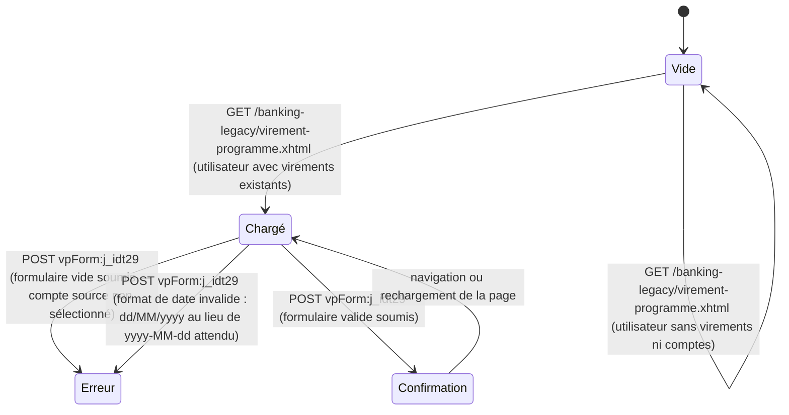

# FLOW — FEAT-004 Virements programmés

## Captures par état

| État | Screenshot | Rôle | Notes |
|---|---|---|---|
| Chargé | SCR-004-01_charge.png | CLIENT | La page affiche simultanément le formulaire de création (vide) et la liste des virements programmés existants. Deux sections distinctes : « Nouveau virement programmé » et « Mes virements programmés ». |
| Vide | SCR-004-04_vide.png | ADMIN | Utilisateur sans comptes bancaires : la liste affiche « Aucun virement programme configure ». Le dropdown Compte débiteur ne contient que l'option « -- Choisir -- ». |
| Erreur | SCR-004-02_erreur.png | CLIENT | Validation serveur JSF : message « Veuillez selectionner un compte source » affiché dans un tableau d'erreurs au-dessus du formulaire. Le formulaire reste affiché avec les valeurs saisies. |
| Confirmation | SCR-004-03_confirmation.png | CLIENT | Message de succès : « Virement programme cree avec succes ». La liste se rafraîchit avec le nouveau virement. Pas de modale de confirmation — la soumission est immédiate et irréversible. |