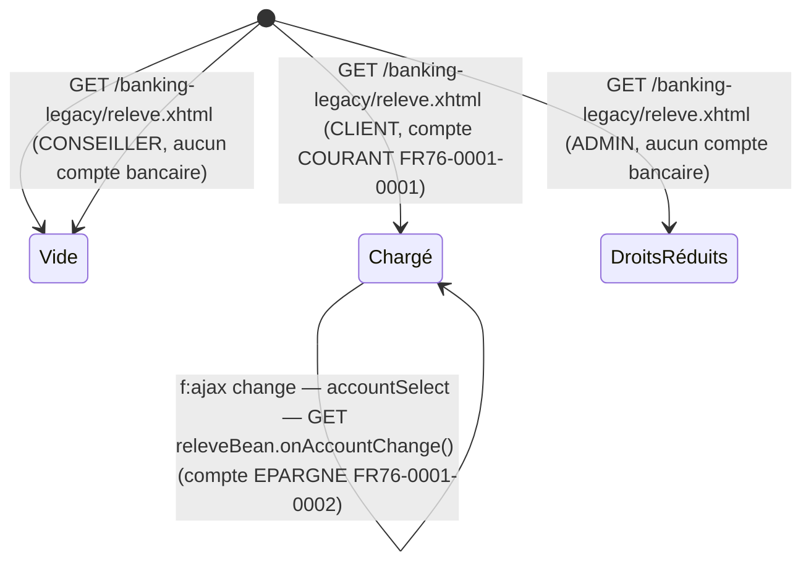

# FLOW — FEAT-005 Relevé de compte

## Captures par état

| État | Screenshot | Rôle | Notes |
|---|---|---|---|
| Chargé | SCR-005-01_charge.png | CLIENT | Page chargée avec 27 transactions. Compte COURANT sélectionné par défaut (premier compte). Solde: €2,080.00. init() charge accounts via AccountService puis transactions via AuditService. |
| Vide | SCR-005-03_vide_conseiller.png | CONSEILLER | Le rôle CONSEILLER n'a pas de comptes bancaires (aucune entrée bank_accounts pour customer_id=11). Combobox vide, message 'Aucune transaction pour ce compte.' affiché. Nav: lien 'Espace Conseiller' visible. |
| DroitsRéduits | SCR-005-04_vide_admin.png | ADMIN | Le rôle ADMIN n'a pas de comptes bancaires (aucune entrée bank_accounts pour customer_id=10). Même état que CONSEILLER. Nav: liens 'Espace Conseiller' et 'Administration' visibles. |