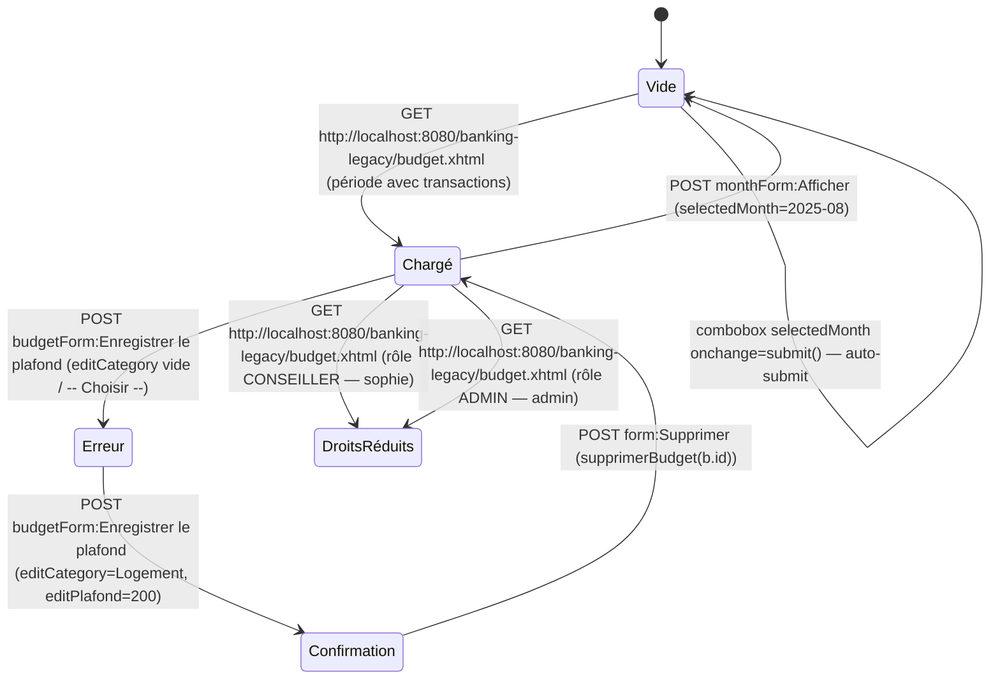

# FLOW — FEAT-006 Budget et catégories de dépenses

## Captures par état

| État | Screenshot | Rôle | Notes |
|---|---|---|---|
| Chargé | SCR-006-01_charge.png | CLIENT | Page chargée avec données: total dépenses EUR370.00, total revenus EUR250.00, catégories: Logement 120 EUR, Epargne 200 EUR, Autres 50 EUR. Période disponible: 2026-10 (sélectionné), 2025-11, 2025-10, 2025-09, 2025-08. |
| Vide | SCR-006-02_vide.png | CLIENT | Période 2025-08 sans transactions: message 'Aucune depense enregistree sur cette periode'. Totaux: EUR0.00 dépenses, EUR200.00 revenus. |
| Erreur | SCR-006-03_erreur.png | CLIENT | Message JSF globalOnly: 'Veuillez selectionner une categorie'. Formulaire reste visible. Page reste sur la période courante. |
| Confirmation | SCR-006-04_confirmation.png | CLIENT | Message de succès JSF globalOnly: 'Plafond enregistre pour Logement'. Compteur Plafonds définis passe à 1. Section 'Plafonds du mois' apparaît avec table (Categorie, Plafond, Depense, Ecart, Action). Bouton Supprimer visible. message éphémère. |
| DroitsRéduits | SCR-006-05_droits_reduits_conseiller.png | CONSEILLER | CONSEILLER (Sophie Durand) : accès identique au formulaire plafond. Différences: navigation ajoute 'Espace Conseiller'. Données propres au user: EUR0.00 dépenses et revenus, seule période 2026-10 disponible. Pas de restriction fonctionnelle — pas de vrais droits_réduits. |