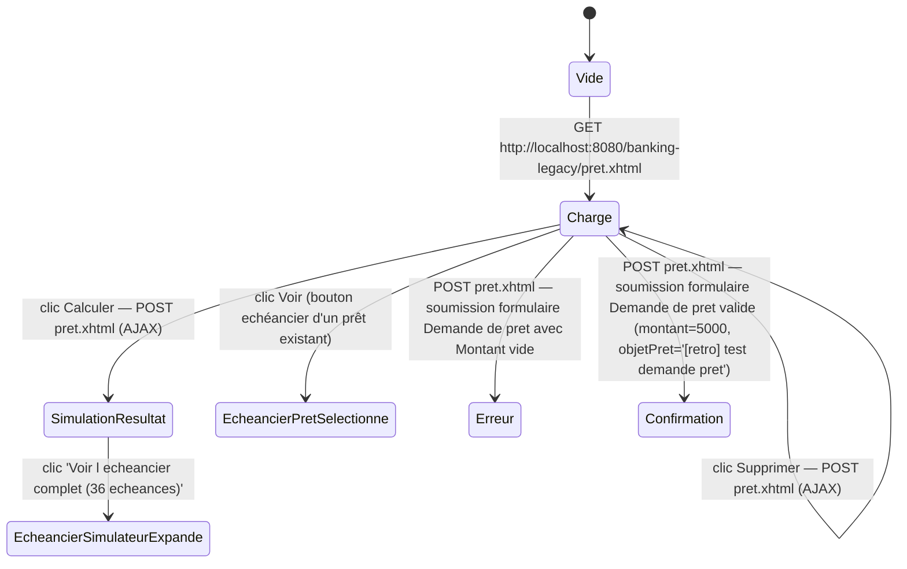

# FLOW — FEAT-007 Demande et suivi de prets

## Captures par état

| État | Screenshot | Rôle | Notes |
|---|---|---|---|
| Charge | SCR-007-00_vide.png | CLIENT | La page charge directement avec les données (pas d'état vide séparé du chargé pour JSF ViewScoped). Formulaires pré-remplis avec valeurs par défaut (taux 3.50, durée 36). Table 'Emprunts en cours' affiche les prêts du compte. |
| SimulationResultat | SCR-007-02_simulation.png | CLIENT | Affiche panneau résultat: Mensualite 293.02 EUR, Cout total 10,548.72 EUR, Total interets 548.72 EUR. Panneau collapsible 'Voir l echeancier complet (36 echeances)' apparaît. |
| EcheancierSimulateurExpande | SCR-007-03_echeancier_simulateur.png | CLIENT | Panneau collapsible s'étend — table #, Capital, Interets, Total, Capital restant — 36 lignes. |
| EcheancierPretSelectionne | SCR-007-04_echeancier_pret.png | CLIENT | Affiche le panneau 'Echeancier du pret selectionne' — table #, Date echeance (dd/MM/yyyy), Capital, Interets, Total, Capital restant, Statut (Paye / en cours), Action. Les échéances passées ont statut 'Paye'. |
| Erreur | SCR-007-05_erreur.png | CLIENT | Message 'Montant invalide' apparaît sous forme de cellule de table d'erreur inline (pas de toast). S'affiche à la fois dans la section Simulateur et dans la section Demande de pret. Les autres champs restent remplis. |
| Confirmation | SCR-007-06_confirmation.png | CLIENT | message éphémère — 'Demande transmise au service credit — traitement en cours (rechargez la page dans quelques secondes)'. Nouveau prêt apparaît dans table avec statut 'En attente d approbation' et 'En cours de traitement...' dans colonne Echeancier. Traitement asynchrone via queue/pretDemandesQueue (MDB WildFly). |