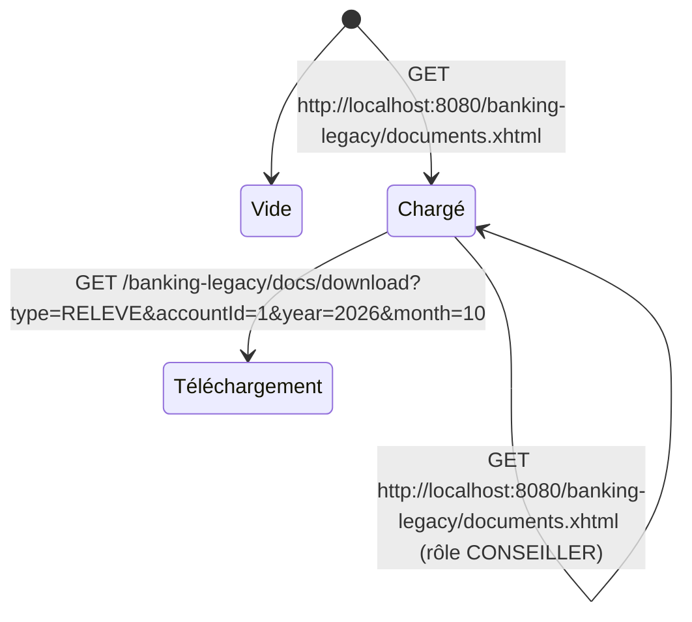

# FLOW — FEAT-008 Documents (relevés, attestations, IFU)

## Captures par état

| État | Screenshot | Rôle | Notes |
|---|---|---|---|
| Chargé | SCR-008-01_charge.png | CLIENT | Page chargée avec les documents du client Jean Dupont (user1) : 2 comptes (COURANT FR76-0001-0001 + EPARGNE FR76-0001-0002), IFU 2024 et 2025. Tous les éléments sont des liens href vers /docs/download. Aucun formulaire, aucune saisie. |
| Téléchargement | None | CLIENT | Clic sur lien relevé → appel DocumentDownloadServlet (FEAT-017). Pas de changement d'état sur la page documents.xhtml, le PDF est servi en réponse HTTP directe. Les liens de téléchargement couvrent : RELEVE (par compte, par mois), RIB (par compte), ATTESTATION (par compte), IFU (par année). |