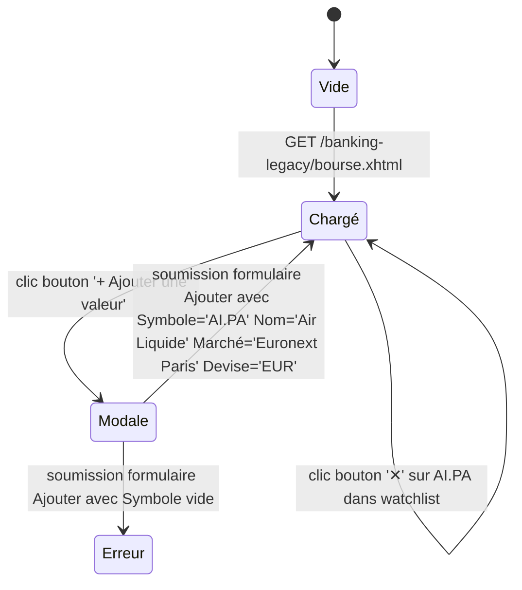

# FLOW — FEAT-009 Bourse et watchlist

## Captures par état

| État | Screenshot | Rôle | Notes |
|---|---|---|---|
| Chargé | SCR-009-01_charge.png | CLIENT | Page chargée avec sélection par défaut AI.PA (premier item watchlist) — données temps réel via AlphaVantage — watchlist 9 valeurs prédéfinies |
| Modale | SCR-009-03_modale_ajout.png | CLIENT | Panneau formulaire inline s'affiche (pas de dialog modal overlay) — champs : Symbole*, Nom*, Marché (combobox), Devise (combobox) |
| Erreur | SCR-009-04_erreur_validation.png | CLIENT | message erreur : 'Le symbole est obligatoire (ex: AMZN, SG.PA)' — affiché dans tableau au-dessus du formulaire — formulaire reste ouvert |