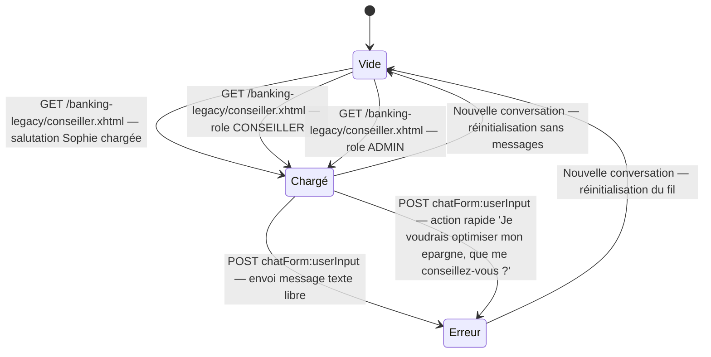

# FLOW — FEAT-010 Chat avec le conseiller

## Captures par état

| État | Screenshot | Rôle | Notes |
|---|---|---|---|
| Chargé | SCR-010-01_charge.png | CLIENT | Page chargée avec message de bienvenue personnalisé (prénom du client). Boutons d'actions rapides visibles. Textbox message vide. |
| Erreur | SCR-010-02_erreur.png | CLIENT | AI backend Azure AI Foundry retourne HTTP 401 en environnement local. Message affiché : 'Je suis momentanement indisponible (HTTP 401). Veuillez reessayer.' Textbox non vidée après envoi (dette-legacy). |
| Vide | SCR-010-03_vide.png | CLIENT | Conversation réinitialisée : messages précédents effacés, nouvelle salutation Sophie envoyée. Textbox non vidée (contient encore l'ancien message — dette-legacy). |