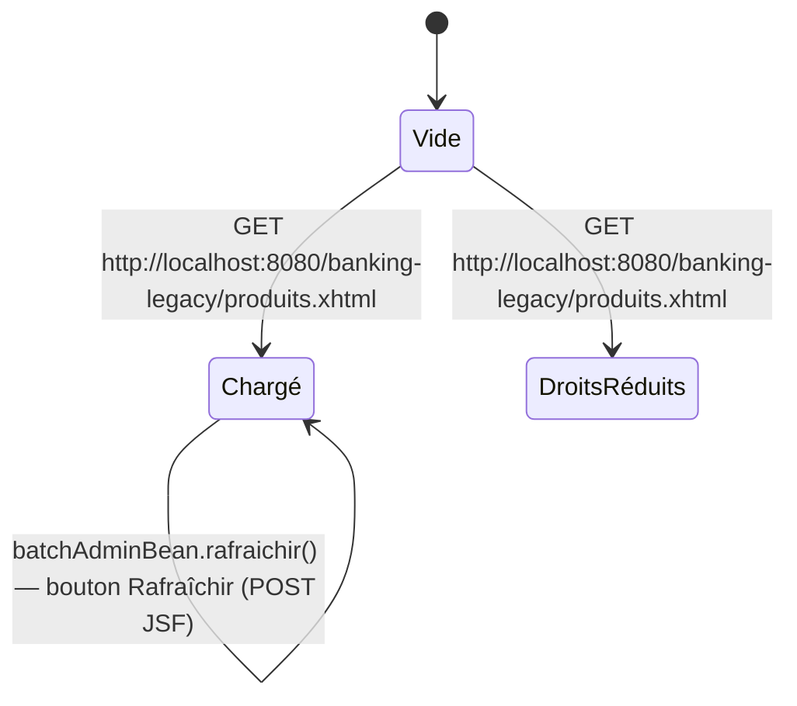

# FLOW — FEAT-011 Catalogue produits bancaires

## Captures par état

| État | Screenshot | Rôle | Notes |
|---|---|---|---|
| Chargé | SCR-011-01_charge.png | ADMIN | Chargement initial du catalogue — 4 produits épargne, 4 crédit, 5 investissement. Section batch en état vide ('Aucun traitement nocturne enregistré...'). La section batch est vide car les EJB @Schedule s'exécutent à 02h00/02h30/1er du mois 03h00 et n'ont pas encore tourné. État Vide du catalogue lui-même non capturable sans vider la base de données (données seedées). |
| DroitsRéduits | SCR-011-02_droits_reduits.png | CLIENT | Même contenu que Chargé mais navigation réduite : pas de lien 'Espace Conseiller' (réservé CONSEILLER et ADMIN) ni 'Administration' (réservé ADMIN). Le catalogue produits lui-même est identique — page accessible à tous les rôles authentifiés. |