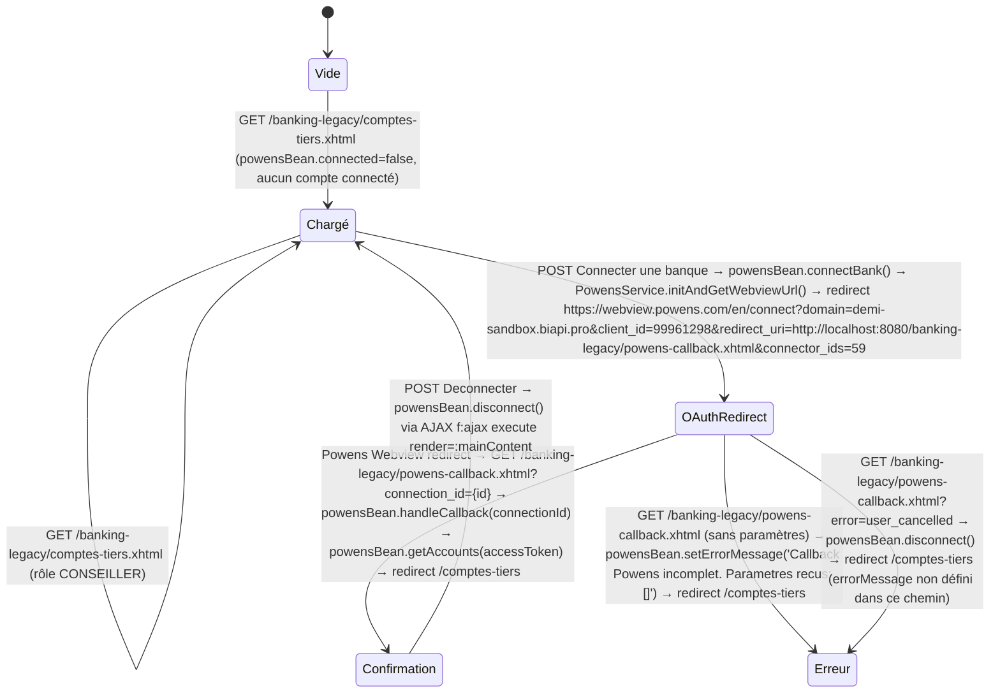

# FLOW — FEAT-012 Comptes Tiers — Open Banking Powens

## Captures par état

| État | Screenshot | Rôle | Notes |
|---|---|---|---|
| Chargé | SCR-012-01_charge.png | CLIENT | État initial : bloc non-connecté affiché avec logos banques (BNP Paribas, Crédit Agricole, La Banque Postale, CIC, LCL, +1800) et bouton 'Connecter une banque'. Vide et Chargé sont identiques pour cette feature (aucun compte tiers déjà connecté). |
| OAuthRedirect | SCR-012-02_oauth_powens_webview.png | CLIENT | La méthode initAndGetWebviewUrl() crée un utilisateur anonyme Powens, obtient un auth_token permanent stocké en session (powensBean.accessToken), et retourne l'URL Webview. FacesContext.redirect() navigue vers la Webview Powens externe. connector_ids=59. L'accessToken est déjà disponible en session à ce stade. |
| Confirmation | SCR-012-04_connecte_comptes_vides.png | CLIENT | État connecté avec comptes vides (sandbox). Badge 'Connected via Powens'. Patrimoine total EUR0.00. Mes comptes externes (0). Simultanément : message erreur 'Connexion reussie mais aucun compte disponible encore. Reessayez dans quelques secondes.' car getAccounts() retourne liste vide. Thread.sleep(2000) avant getAccounts pour attendre synchro Powens. |
| Erreur | SCR-012-03_erreur.png | CLIENT | Erreur affichée : '⚠️ Callback Powens incomplet. Parametres recus: []'. Bloc non-connecté toujours visible. Survient quand ni connection_id ni code OAuth n'est présent dans les paramètres du callback. |