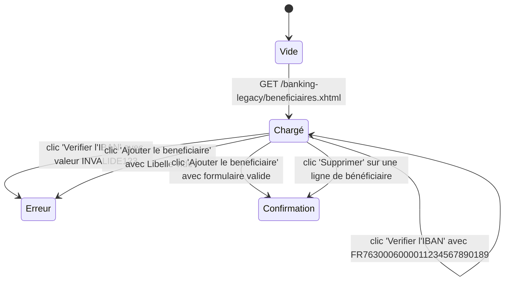

# FLOW — FEAT-013 Gestion des bénéficiaires externes

## Captures par état

| État | Screenshot | Rôle | Notes |
|---|---|---|---|
| Chargé | SCR-013-01_charge.png | CLIENT | Page chargée avec liste de bénéficiaires existants (3 pour user1 au départ). Formulaire vide visible en haut. Rôles CONSEILLER et ADMIN : liste vide, message 'Aucun beneficiaire enregistre.' |
| Erreur | SCR-013-02_erreur_iban_invalide.png | CLIENT | Message inline sous le champ IBAN : 'IBAN invalide (echec MOD-97). Verifiez la saisie.' Bouton Verifier prend l'état [active]. Formulaire reste ouvert. |
| Confirmation | SCR-013-05_confirmation_ajout.png | CLIENT | Message JSF h:messages : 'Bénéficiaire ajouté avec succès.' Formulaire réinitialisé. Nouveau bénéficiaire visible en bas de liste. Bug legacy : compteur dans le titre 'Beneficiaires (N)' affiche N-1 après ajout (valeur stale de la vue précédente). |