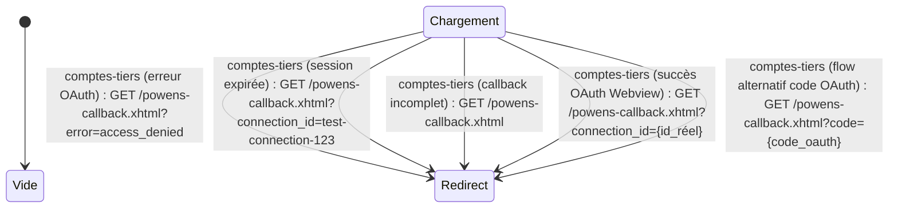

# FLOW — FEAT-014 Callback OAuth Powens

## Captures par état

| État | Screenshot | Rôle | Notes |
|---|---|---|---|
| Redirect:comptes-tiers (erreur OAuth) | SCR-014-02_redirect_erreur_oauth.png | CLIENT | Param 'error' non vide → powensBean.disconnect() → redirect /comptes-tiers?faces-redirect=true. PowensBean:110 disconnect() remet accessToken, externalAccounts, connected à null/false. |
| Redirect:comptes-tiers (session expirée) | SCR-014-03_redirect_connection_id.png | CLIENT | Param 'connection_id' présent, accessToken null en session → errorMessage='Session expiree. Veuillez recommencer la connexion.' → redirect. Cas de test sans OAuth préalable. PowensBean:65-66. |
| Redirect:comptes-tiers (callback incomplet) | SCR-014-01_redirect_sans_params.png | CLIENT | Aucun param → warn + powensBean.setErrorMessage('Callback Powens incomplet. Parametres recus: []') → redirect.. |
| Redirect:comptes-tiers (succès OAuth Webview) | None | CLIENT | Chemin nominal (flow OAuth Powens réel) : connection_id présent + accessToken en session → handleCallback(connection_id) → getAccounts() → connected=true → redirect. Non simulable sans flow OAuth réel.. |
| Redirect:comptes-tiers (flow alternatif code OAuth) | None | CLIENT | Fallback si 'code' OAuth présent (pas connection_id) → handleCallback(code). Commenté comme 'flow alternatif' dans le code.. |