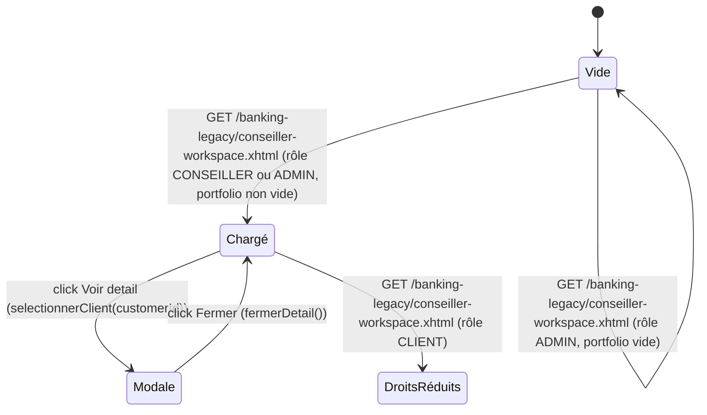

# FLOW — FEAT-015 Espace Conseiller — Portefeuille clients

## Captures par état

| État | Screenshot | Rôle | Notes |
|---|---|---|---|
| Chargé | SCR-015-01_charge.png | CONSEILLER | Initialisation via @PostConstruct : chargerPortfolio() charge la liste des clients assignés à ce conseiller. Affiche KPIs (nb clients, encours total, prêts en attente) et les cartes clients. |
| Vide | SCR-015-03_vide.png | ADMIN | ADMIN (Alice Martin) a 0 clients dans son portefeuille. La page affiche : 'Aucun client dans votre portefeuille. Contactez l administrateur pour l affectation des clients.' — état aussi attendu pour tout CONSEILLER nouvellement créé. |
| Modale | SCR-015-02_modale_detail_client.png | CONSEILLER | Ouvre un panneau de détail inline (non modal JS). Affiche : nom/login/email/téléphone du client, tableau des comptes bancaires (IBAN, type, solde), tableau des prêts (type, montant, mensualité, statut). Déclencheur : input[name='j_idt17:j_idt18'] — bouton JSF action. |
| DroitsRéduits | SCR-015-04_droits_reduits.png | CLIENT | AppFilter redirige silencieusement le CLIENT vers dashboard.xhtml. Pas de message d'erreur affiché. La page de destination est le tableau de bord client normal. |