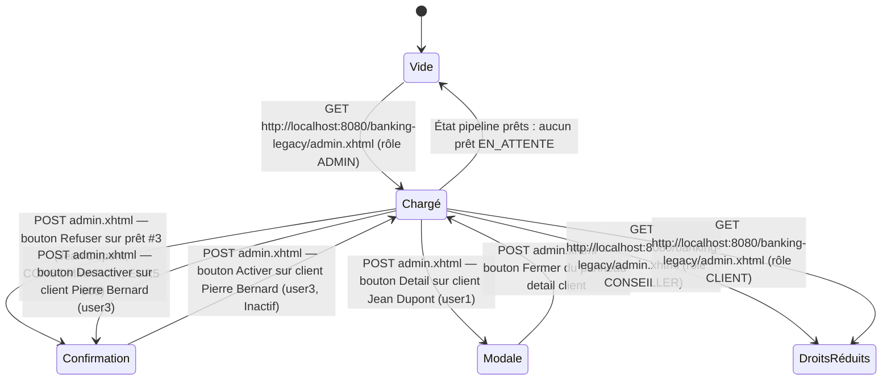

# FLOW — FEAT-016 Administration — Gestion globale

## Captures par état

| État | Screenshot | Rôle | Notes |
|---|---|---|---|
| Chargé | SCR-016-01_charge.png | ADMIN | Page chargée avec données réelles : 4 clients, 2 conseillers, 1 prêt en attente, 7 utilisateurs, 5 alertes fraude ouvertes, 0 batch nocturne enregistré |
| Confirmation | SCR-016-02_confirmation_refus_pret.png | ADMIN | Action directe sans modale de confirmation — message flash 'Prêt refusé' affiché en liste ; pipeline prêts passe à 0 en attente ; prêt #3 statut devient REFUSE dans historique |
| Modale | SCR-016-03_modale_detail_client.png | ADMIN | Panneau inline 'Detail : Jean Dupont' avec champs lecture seule (Nom complet, Identifiant, Email, Telephone, Role, Statut, Conseiller assigné, Client depuis). Bouton 'Fermer' disponible. |
| Vide | SCR-016-05_vide_pipeline_prets.png | ADMIN | Section 'Pipeline Prêts' affiche 'Aucun pret en attente' quand tous les prêts sont traités. Section 'Traitements nocturnes' toujours vide (aucun batch nocturne enregistré dans BATCH_JOB_LOGS). |
| DroitsRéduits | SCR-016-06_droits_reduits_conseiller.png | CONSEILLER | Redirection vers dashboard.xhtml — restreint admin.xhtml au rôle ADMIN uniquement |