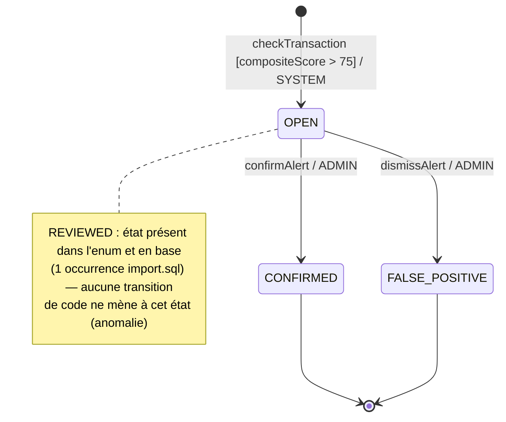

# STATES — FRAUD_ALERTS

_Généré par retro-states — entité FRAUD_ALERTS rattachée à FEAT-027 « Détection de fraude en temps réel »._

Source colonne de statut : `PUBLIC.FRAUD_ALERTS.STATUS` (ENUM-fraud_alerts-status)
Acteurs habilités : SYSTEM (création), ADMIN (résolution manuelle)

---

---

## Légende

| État | Description | Terminal | Occurrences base |
| --- | --- | --- | --- |
| OPEN | Alerte créée par le système, en attente de revue manuelle | Non | 3 |
| CONFIRMED | Fraude confirmée manuellement par un administrateur | Oui | 1 |
| FALSE_POSITIVE | Alerte invalidée manuellement (fausse alerte) | Oui | 1 |
| REVIEWED | État présent dans l'enum FraudStatus et en base (seed import.sql) — aucune transition de code ne le produit | Anomalie | 1 |

---

## Transitions documentées

### [*] → OPEN — création automatique

- **Déclencheur** : `VirementBean.executeVirement` → `FraudDetectionService.checkTransaction` → `FraudDetectionService.buildAlert` → `em.persist(alert)`
- **Garde** : score composite des règles déclenchées > 75
- **Acteur** : SYSTEM
- **Effets de bord** :
  - Persistence de N alertes (une par règle déclenchée parmi : LARGE_AMOUNT, HIGH_FREQUENCY, NEW_BENEFICIARY, UNUSUAL_HOURS, ROUND_AMOUNT, FOREIGN_IBAN, RAPID_SUCCESSION, VELOCITY_CHECK)
  - `reviewedAt = null`, `reviewedBy = null`
  - LOG.warn par alerte persistée

### OPEN → CONFIRMED — confirmation fraude

- **Déclencheur** : clic « Confirmer » dans admin.xhtml → `FraudAlertBean.confirmAlert(id)` → `FraudDetectionService.reviewAlert(id, reviewer, FraudStatus.CONFIRMED)`
- **Garde** : alertId non null, FraudAlert existante en base
- **Acteur** : ADMIN
- **Effets de bord** :
  - `STATUS = CONFIRMED`
  - `reviewedAt = now()`
  - `reviewedBy = username du reviewer ADMIN`
  - rafraîchissement de la liste des alertes (refreshAlerts)

### OPEN → FALSE_POSITIVE — rejet (fausse alerte)

- **Déclencheur** : clic « Rejeter » dans admin.xhtml → `FraudAlertBean.dismissAlert(id)` → `FraudDetectionService.reviewAlert(id, reviewer, FraudStatus.FALSE_POSITIVE)`
- **Garde** : alertId non null, FraudAlert existante en base
- **Acteur** : ADMIN
- **Effets de bord** :
  - `STATUS = FALSE_POSITIVE`
  - `reviewedAt = now()`
  - `reviewedBy = username du reviewer ADMIN`
  - rafraîchissement de la liste des alertes (refreshAlerts)

---

## Transitions non observées

| De | Vers | Déclencheur théorique | Fréquence |
| --- | --- | --- | --- |
| OPEN | REVIEWED | Aucun — enum défini, aucun caller ne passe FraudStatus.REVIEWED à reviewAlert() | 0 — jamais produit par le code |

---

## Anomalies

### A1 — État REVIEWED sans transition de code

L'état REVIEWED est défini dans `FraudStatus` (java:9) et a 1 occurrence en base, mais cette occurrence provient exclusivement du jeu de données initial. La méthode `reviewAlert()` accepte n'importe quelle valeur `FraudStatus` en paramètre, mais ses deux seuls callers (`confirmAlert`, `dismissAlert`) ne lui passent jamais `FraudStatus.REVIEWED`. En production, aucune alerte ne peut atteindre l'état REVIEWED via le code applicatif.

**Classification** : état atteint en base uniquement par les données de seed — jamais atteignable en production par le code actuel.

### A2 — NightlyBatchService.runFraudDetection ne crée pas d'alertes (dette-legacy)

FEAT-019 indique que `NightlyBatchService.runFraudDetection()` « crée des entrées dans FRAUD_ALERTS ». L'analyse du code montre que cette méthode ne fait qu'interroger les transactions > 10 000 EUR sur les dernières 24 h et journaliser le résultat dans `BATCH_JOB_LOGS`. Elle n'appelle pas `FraudDetectionService` et ne persiste aucun `FraudAlert`. La seule source de création d'alertes est `FraudDetectionService.checkTransaction()` déclenché par `VirementBean.executeVirement`.

**Classification** : dette-legacy (FEAT-019 mal documentée).
